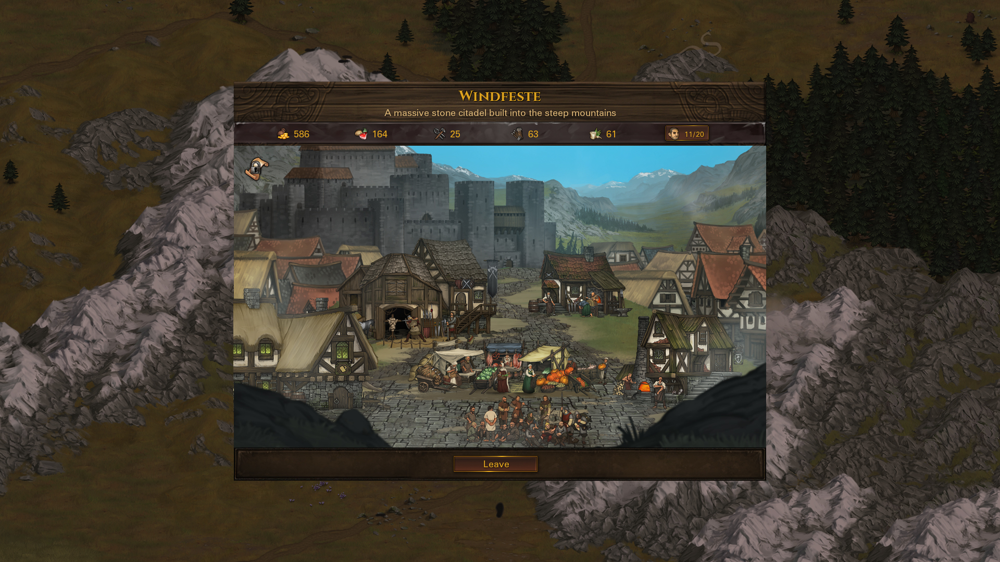
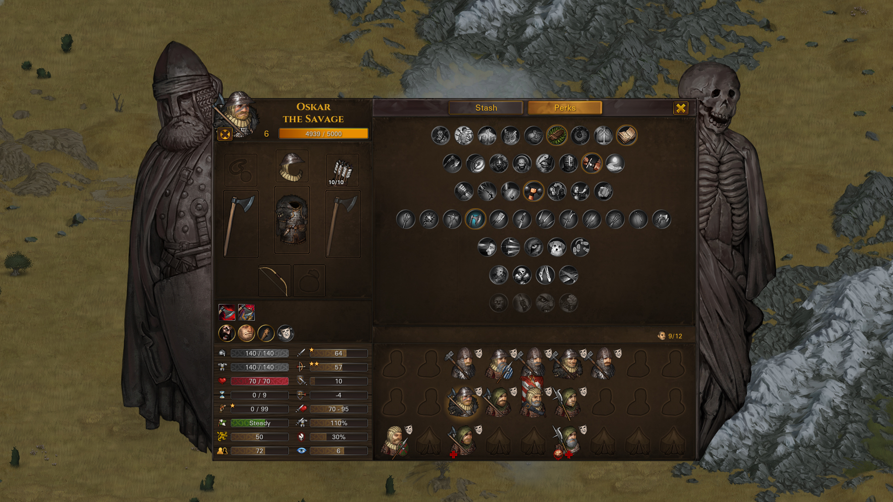
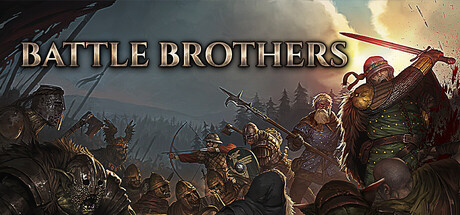
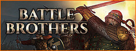

# Authentic reference images

Official Steam store frames for appid 365360, Battle Brothers (Overhype Studios, Hooded Horse, released 24 Mar, 2017) [1]. Store page: https://store.steampowered.com/app/365360 [2]. One full-size screenshot URL used as the image-set anchor: [3].

Download access timestamp: `2026-10-23T13:57:03Z` (UTC, recorded immediately before the original download). Bytes were copied into this tree from the preparation manifest without a new CDN fetch. These are official store assets, not original-runtime captures. The installed game was not launched and no original DLL, script, or art file was copied.

Copyrighted references are analysis-only. They are not shipped game art. Distributable packages exclude `docs/source/reference-images/`. See `refs/legal/store-references.md`.

Gameplay screenshots: 10. Other store images (header and capsule): 2.

| File | Kind | Pixels | SHA256 | Bytes | Image URL |
| --- | --- | --- | --- | --- | --- |
| steam-ss-0.jpg | store_screenshot | 1920x1080 | `9818ee141010b66cc5a096b03e239a07d45e048082f0bf944fad629e7b1c91e7` | 1836315 | https://shared.akamai.steamstatic.com/store_item_assets/steam/apps/365360/ss_2ed5eff851e0562800376e4903e9bf3a2dcdde76.1920x1080.jpg?t=1792743708 |
| steam-ss-1.jpg | store_screenshot | 1920x1080 | `16ac915e50f3b6e41526256af64d25007042b543d6ecdbfa07cc06729a6e2e9f` | 1659443 | https://shared.akamai.steamstatic.com/store_item_assets/steam/apps/365360/ss_c03600b98e321733a1cc9184f3e7150cfac8dffc.1920x1080.jpg?t=1792743708 |
| steam-ss-2.jpg | store_screenshot | 1920x1080 | `bb0e1834634f61f34dd495c17d4b86c11fafffaf171337fe63a86c22c3f1c17e` | 932352 | https://shared.akamai.steamstatic.com/store_item_assets/steam/apps/365360/ss_03699d4ce2eacbaeb5f493ae75332b586b09e1c0.1920x1080.jpg?t=1792743708 |
| steam-ss-3.jpg | store_screenshot | 1920x1080 | `cf02f51bdee74a798299a635f03294d9f024a63fe2e4ce672c734c78ac05f8a0` | 1600140 | https://shared.akamai.steamstatic.com/store_item_assets/steam/apps/365360/ss_f78ccd2ce53431b5968230165704ec6a0d3fc613.1920x1080.jpg?t=1792743708 |
| steam-ss-4.jpg | store_screenshot | 1920x1080 | `75615d163727107871f4064b5cd4878bfe5caabbaaee8e121d87d86b7e6b71e8` | 1631516 | https://shared.akamai.steamstatic.com/store_item_assets/steam/apps/365360/ss_964961b2dc5a776651b91f5968b29838a17db896.1920x1080.jpg?t=1792743708 |
| steam-ss-5.jpg | store_screenshot | 1920x1080 | `5e562ba8c3474115f59cafb5036ffec998fee38b0f6a8d070e38b97cb337f14f` | 1620442 | https://shared.akamai.steamstatic.com/store_item_assets/steam/apps/365360/ss_5025550d8e96ed854e9e25ac4e5004281e0cbacd.1920x1080.jpg?t=1792743708 |
| steam-ss-6.jpg | store_screenshot | 1920x1080 | `a03e14e677b93898a026797f2d8afd2a5eae51a900cc2351739ea080984a9123` | 1816600 | https://shared.akamai.steamstatic.com/store_item_assets/steam/apps/365360/ss_5c6341f7d80b424d962006d28e47e48b619203ac.1920x1080.jpg?t=1792743708 |
| steam-ss-7.jpg | store_screenshot | 1920x1080 | `61499a12dc7786ce76cb3c3c311240232570a6b1816ef0d35329084f33800252` | 1440412 | https://shared.akamai.steamstatic.com/store_item_assets/steam/apps/365360/ss_99591f270f73a66d760f979b16809f4aee1e7827.1920x1080.jpg?t=1792743708 |
| steam-ss-8.jpg | store_screenshot | 1920x1080 | `027bc23d9ebd20459e7be9d8c58ade6584eeff8d542b604ec336afdb282256c8` | 1457362 | https://shared.akamai.steamstatic.com/store_item_assets/steam/apps/365360/ss_e07d2a2dd627eb425dbb6322076c85324d94bbf1.1920x1080.jpg?t=1792743708 |
| steam-ss-9.jpg | store_screenshot | 1920x1080 | `80544f63ea24b28123d97e38a83b04bb894918a147821dacdaeb5acb449a10ab` | 1339990 | https://shared.akamai.steamstatic.com/store_item_assets/steam/apps/365360/ss_4b7b47e2740ada408e2bf2e2bb7a88d61bd570c3.1920x1080.jpg?t=1792743708 |
| steam-header.jpg | store_header | 460x215 | `05e0dbf0dab4bf1f8460f0f9c9cb8c8447117b425a5b37bde9c0b40fcfa79f65` | 53247 | https://shared.akamai.steamstatic.com/store_item_assets/steam/apps/365360/c6ad528c1ec98716cccc6b251d570bd1c0f2d283/header.jpg?t=1792743708 |
| steam-capsule-231x87.jpg | store_capsule | 231x87 | `c19d57bec46b957c7f66a7a6feb75c783c53d8152ff4b7d5ed300c3c806c73a1` | 15435 | https://shared.akamai.steamstatic.com/store_item_assets/steam/apps/365360/6d11e94a198276fb77dc429edc3f4a2aa1517bde/capsule_231x87.jpg?t=1792743708 |

## Linked frames

## Semantic coverage copied from the download set

# Official store image semantics

Access: see access-timestamp.txt (UTC, immediately before download). Origin page: https://store.steampowered.com/app/365360. API: https://store.steampowered.com/api/appdetails?appids=365360&l=english. CDN host shared.akamai.steamstatic.com. These are official store assets, not original-runtime captures from the local install. Hashes and dimensions: download-manifest.json. Native image open in this session succeeded for all ten screenshots. No browser screenshot was sent to an external vision service.

| File | What is visible |
| --- | --- |
| steam-ss-0.jpg | Hex tactical aftermath, casualties, morale/HP/fatigue-style HUD, turn queue, injury log |
| steam-ss-1.jpg | Overworld with fog, settlements, ambitions, day/time, party and resources |
| steam-ss-2.jpg | Pre-battle inventory: kite shield tooltip, stash, perks, brother paper-doll, Start Battle |
| steam-ss-3.jpg | Snow tactical deployment, ancient dead, resolve/fatigue bars, round counter |
| steam-ss-4.jpg | Swamp tactical fight, wiederganger, injuries, confident morale |
| steam-ss-5.jpg | Road event with three choices over the world map |
| steam-ss-6.jpg | Dry-ground tactical fight versus orcs/goblins, spear brother, discovered-enemy log |
| steam-ss-7.jpg | Settlement screen Windfeste, citadel, market, leave, roster count |
| steam-ss-8.jpg | Snow overworld contract panel, day 95, pause/speed, objectives and crowns |
| steam-ss-9.jpg | Character sheet Oskar the Savage, perks, equipment, XP, roster |
| steam-header.jpg | Store header art, 460x215, not a gameplay screen |
| steam-capsule-231x87.jpg | Store capsule, 231x87, not a gameplay screen |

Gaps versus a faithful UI contract: no store frame isolates hit-chance math, AP spend, fatigue formulas, or save/ironman dialogs. Local install was not launched. Do not treat these frames as rule evidence.

## Gaps

No store frame isolates hit-chance math, action-point prices, fatigue formulas, or save/ironman dialogs. Original-runtime capture is an open gap: the local install was not executed. Prior prototype screenshots are rejected and are not in this directory.

## Sources

[1] https://store.steampowered.com/api/appdetails?appids=365360&l=english
[2] https://store.steampowered.com/app/365360
[3] https://shared.akamai.steamstatic.com/store_item_assets/steam/apps/365360/ss_2ed5eff851e0562800376e4903e9bf3a2dcdde76.1920x1080.jpg?t=1792743708
