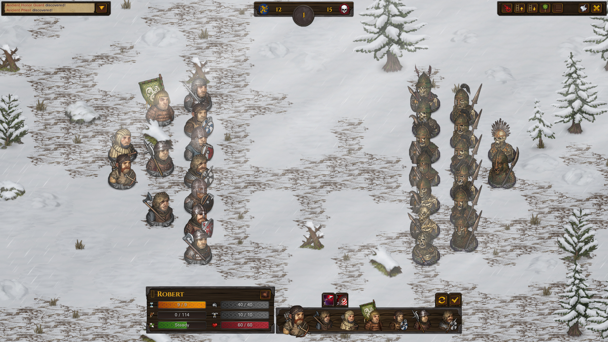
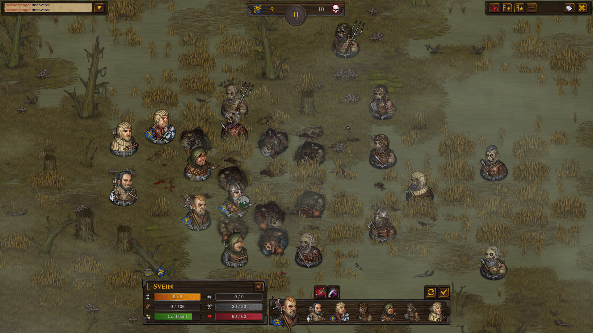
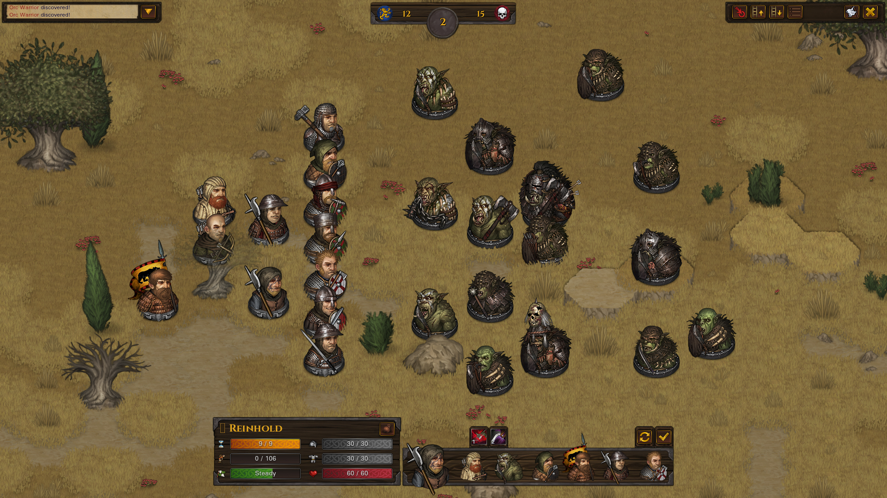

# Tactical combat

Provenance: copied from `/home/jan/Sources/total-brothers/docs/battle-brothers-use-cases.md` SHA256 `0ccec5426118234ae18853aadaebf334de33eebbb097a323099b542f36e1ac87` (4418 lines, 330 `UC-*` ids, 77 `UNCONFIRMED` markers). This is a reusable player-loop catalog for a mercenary company, not a kingdom or Total War brief, and not a recovered numeric formula sheet. Authority and implementation are separate columns. Catalog confidence is not original-runtime confirmation. The local Battle Brothers install was not executed. Prototype screenshots from the old slice are rejected as original-game references.

Parity is not claimed for any row. Only `UC-COMBAT-065` has a separate static implementation note, and that note does not accept the catalog's 9 AP cost, perk gate, or full-turn claim.

Inspection frames linked here are official Steam store assets, analysis-only, not shipped game art. See [authentic reference](05-authentic-reference.md).

## Trace table

| ID | Title | Authority | Confidence | Implementation | Code | Tests | Next evidence |
| --- | --- | --- | --- | --- | --- | --- | --- |
| UC-COMBAT-001 | Tactical battle starts from overworld engagement | public catalog copy, not recovered bytecode | catalog-stated, not runtime-confirmed | absent | gap | gap | native reference comparison; original runtime was not executed |
| UC-COMBAT-002 | Hex grid with blocked tiles | public catalog copy, not recovered bytecode | catalog-stated, not runtime-confirmed | absent | gap | gap | native reference comparison; original runtime was not executed |
| UC-COMBAT-003 | Initiative order each round | public catalog copy, not recovered bytecode | unconfirmed | absent | gap | gap | native reference comparison; original runtime was not executed |
| UC-COMBAT-004 | Player takes a turn with 9 AP | public catalog copy, not recovered bytecode | unconfirmed | absent | gap | gap | native reference comparison; original runtime was not executed |
| UC-COMBAT-005 | Movement AP and fatigue costs | public catalog copy, not recovered bytecode | catalog-stated, not runtime-confirmed | absent | gap | gap | native reference comparison; original runtime was not executed |
| UC-COMBAT-006 | Fatigue as a second action budget | public catalog copy, not recovered bytecode | catalog-stated, not runtime-confirmed | absent | gap | gap | native reference comparison; original runtime was not executed |
| UC-COMBAT-007 | Zone of control (ZoC) | public catalog copy, not recovered bytecode | catalog-stated, not runtime-confirmed | absent | gap | gap | native reference comparison; original runtime was not executed |
| UC-COMBAT-008 | Opportunity attack when leaving ZoC | public catalog copy, not recovered bytecode | catalog-stated, not runtime-confirmed | absent | gap | gap | native reference comparison; original runtime was not executed |
| UC-COMBAT-009 | There is no facing/backstab cone — surround instead | public catalog copy, not recovered bytecode | catalog-stated, not runtime-confirmed | absent | gap | gap | native reference comparison; original runtime was not executed |
| UC-COMBAT-010 | Elevation hit bonus/penalty | public catalog copy, not recovered bytecode | catalog-stated, not runtime-confirmed | absent | gap | gap | native reference comparison; original runtime was not executed |
| UC-COMBAT-011 | Hit chance formula | public catalog copy, not recovered bytecode | unconfirmed | absent | gap | gap | native reference comparison; original runtime was not executed |
| UC-COMBAT-012 | Head vs body hit location | public catalog copy, not recovered bytecode | catalog-stated, not runtime-confirmed | absent | gap | gap | native reference comparison; original runtime was not executed |
| UC-COMBAT-013 | Armour then hitpoints; armour ignore | public catalog copy, not recovered bytecode | catalog-stated, not runtime-confirmed | absent | gap | gap | native reference comparison; original runtime was not executed |
| UC-COMBAT-014 | Melee vs ranged weapons | public catalog copy, not recovered bytecode | catalog-stated, not runtime-confirmed | absent | gap | gap | native reference comparison; original runtime was not executed |
| UC-COMBAT-015 | Line of sight and occupied-hex shooting | public catalog copy, not recovered bytecode | unconfirmed | absent | gap | gap | native reference comparison; original runtime was not executed |
| UC-COMBAT-016 | Shieldwall, Spearwall, Riposte, Indomitable as stances | public catalog copy, not recovered bytecode | unconfirmed | absent | gap | gap | native reference comparison; original runtime was not executed |
| UC-COMBAT-017 | Wait / end turn / end round | public catalog copy, not recovered bytecode | catalog-stated, not runtime-confirmed | absent | gap | gap | native reference comparison; original runtime was not executed |
| UC-COMBAT-018 | Morale states | public catalog copy, not recovered bytecode | catalog-stated, not runtime-confirmed | absent | gap | gap | native reference comparison; original runtime was not executed |
| UC-COMBAT-019 | Player loses control of fleeing brothers | public catalog copy, not recovered bytecode | catalog-stated, not runtime-confirmed | absent | gap | gap | native reference comparison; original runtime was not executed |
| UC-COMBAT-020 | AI behaviour | public catalog copy, not recovered bytecode | catalog-stated, not runtime-confirmed | absent | gap | gap | native reference comparison; original runtime was not executed |
| UC-COMBAT-021 | AI retreat of survivors | public catalog copy, not recovered bytecode | catalog-stated, not runtime-confirmed | absent | gap | gap | native reference comparison; original runtime was not executed |
| UC-COMBAT-022 | Player retreat — edge vs auto-run | public catalog copy, not recovered bytecode | unconfirmed | absent | gap | gap | native reference comparison; original runtime was not executed |
| UC-COMBAT-023 | Victory when all enemies are dead or fled | public catalog copy, not recovered bytecode | catalog-stated, not runtime-confirmed | absent | gap | gap | native reference comparison; original runtime was not executed |
| UC-COMBAT-024 | Loot, ground items, and equipment drop | public catalog copy, not recovered bytecode | catalog-stated, not runtime-confirmed | absent | gap | gap | native reference comparison; original runtime was not executed |
| UC-COMBAT-025 | Formation slots and reserves | public catalog copy, not recovered bytecode | catalog-stated, not runtime-confirmed | absent | gap | gap | native reference comparison; original runtime was not executed |
| UC-COMBAT-026 | Swap weapons / bags in combat | public catalog copy, not recovered bytecode | unconfirmed | absent | gap | gap | native reference comparison; original runtime was not executed |
| UC-COMBAT-027 | Consumables: nets, pots, flasks, dogs | public catalog copy, not recovered bytecode | catalog-stated, not runtime-confirmed | absent | gap | gap | native reference comparison; original runtime was not executed |
| UC-COMBAT-028 | Status effects: stun, daze, net, poison, bleed, sleep, horror | public catalog copy, not recovered bytecode | catalog-stated, not runtime-confirmed | absent | gap | gap | native reference comparison; original runtime was not executed |
| UC-COMBAT-029 | Injuries inflicted in combat | public catalog copy, not recovered bytecode | catalog-stated, not runtime-confirmed | absent | gap | gap | native reference comparison; original runtime was not executed |
| UC-COMBAT-030 | Downed at 0 HP — death vs survive with injury | public catalog copy, not recovered bytecode | unconfirmed | absent | gap | gap | native reference comparison; original runtime was not executed |
| UC-COMBAT-031 | XP split after battle | public catalog copy, not recovered bytecode | unconfirmed | absent | gap | gap | native reference comparison; original runtime was not executed |
| UC-COMBAT-032 | Nighttime combat debuff | public catalog copy, not recovered bytecode | catalog-stated, not runtime-confirmed | absent | gap | gap | native reference comparison; original runtime was not executed |
| UC-COMBAT-033 | Terrain tiles in combat | public catalog copy, not recovered bytecode | catalog-stated, not runtime-confirmed | absent | gap | gap | native reference comparison; original runtime was not executed |
| UC-COMBAT-034 | Height camera levels | public catalog copy, not recovered bytecode | catalog-stated, not runtime-confirmed | absent | gap | gap | native reference comparison; original runtime was not executed |
| UC-COMBAT-035 | Opportunity attacks vs walking into Spearwall | public catalog copy, not recovered bytecode | unconfirmed | absent | gap | gap | native reference comparison; original runtime was not executed |
| UC-COMBAT-036 | Knockback, pull, hook, grab | public catalog copy, not recovered bytecode | catalog-stated, not runtime-confirmed | absent | gap | gap | native reference comparison; original runtime was not executed |
| UC-COMBAT-037 | Split / area attacks | public catalog copy, not recovered bytecode | unconfirmed | absent | gap | gap | native reference comparison; original runtime was not executed |
| UC-COMBAT-038 | Berserk extra AP on kill | public catalog copy, not recovered bytecode | catalog-stated, not runtime-confirmed | absent | gap | gap | native reference comparison; original runtime was not executed |
| UC-COMBAT-039 | Rotation and Footwork | public catalog copy, not recovered bytecode | catalog-stated, not runtime-confirmed | absent | gap | gap | native reference comparison; original runtime was not executed |
| UC-COMBAT-040 | Taunt and AI attention | public catalog copy, not recovered bytecode | unconfirmed | absent | gap | gap | native reference comparison; original runtime was not executed |
| UC-COMBAT-041 | Horrify / fear attacks vs Resolve | public catalog copy, not recovered bytecode | catalog-stated, not runtime-confirmed | absent | gap | gap | native reference comparison; original runtime was not executed |
| UC-COMBAT-042 | Standard bearer / banner morale aura | public catalog copy, not recovered bytecode | unconfirmed | absent | gap | gap | native reference comparison; original runtime was not executed |
| UC-COMBAT-043 | Dogs and extra units vs field cap | public catalog copy, not recovered bytecode | catalog-stated, not runtime-confirmed | absent | gap | gap | native reference comparison; original runtime was not executed |
| UC-COMBAT-044 | Combat log and floating combat text | public catalog copy, not recovered bytecode | catalog-stated, not runtime-confirmed | absent | gap | gap | native reference comparison; original runtime was not executed |
| UC-COMBAT-045 | Pause does not exist inside a unit’s resolution | public catalog copy, not recovered bytecode | catalog-stated, not runtime-confirmed | absent | gap | gap | native reference comparison; original runtime was not executed |
| UC-COMBAT-046 | Auto-combat is not required | public catalog copy, not recovered bytecode | catalog-stated, not runtime-confirmed | absent | gap | gap | native reference comparison; original runtime was not executed |
| UC-COMBAT-047 | Champion / famed enemies | public catalog copy, not recovered bytecode | unconfirmed | absent | gap | gap | native reference comparison; original runtime was not executed |
| UC-COMBAT-048 | Map-edge morale when trying to leave | public catalog copy, not recovered bytecode | catalog-stated, not runtime-confirmed | absent | gap | gap | native reference comparison; original runtime was not executed |
| UC-COMBAT-049 | First-round gap and charge reality | public catalog copy, not recovered bytecode | catalog-stated, not runtime-confirmed | absent | gap | gap | native reference comparison; original runtime was not executed |
| UC-COMBAT-050 | Weapon skills list is data-driven | public catalog copy, not recovered bytecode | catalog-stated, not runtime-confirmed | absent | gap | gap | native reference comparison; original runtime was not executed |
| UC-COMBAT-051 | Two-hex reach (polearms, spears) | public catalog copy, not recovered bytecode | catalog-stated, not runtime-confirmed | absent | gap | gap | native reference comparison; original runtime was not executed |
| UC-COMBAT-052 | Dagger Puncture vs armour | public catalog copy, not recovered bytecode | catalog-stated, not runtime-confirmed | absent | gap | gap | native reference comparison; original runtime was not executed |
| UC-COMBAT-053 | Shield durability and Shield Expert | public catalog copy, not recovered bytecode | catalog-stated, not runtime-confirmed | absent | gap | gap | native reference comparison; original runtime was not executed |
| UC-COMBAT-054 | Net a target then melee | public catalog copy, not recovered bytecode | catalog-stated, not runtime-confirmed | absent | gap | gap | native reference comparison; original runtime was not executed |
| UC-COMBAT-055 | Killing Frenzy after a kill | public catalog copy, not recovered bytecode | catalog-stated, not runtime-confirmed | absent | gap | gap | native reference comparison; original runtime was not executed |
| UC-COMBAT-056 | Lone Wolf perk positioning | public catalog copy, not recovered bytecode | catalog-stated, not runtime-confirmed | absent | gap | gap | native reference comparison; original runtime was not executed |
| UC-COMBAT-057 | Pathfinder movement fatigue | public catalog copy, not recovered bytecode | catalog-stated, not runtime-confirmed | absent | gap | gap | native reference comparison; original runtime was not executed |
| UC-COMBAT-058 | Dodge perk uses current initiative | public catalog copy, not recovered bytecode | catalog-stated, not runtime-confirmed | absent | gap | gap | native reference comparison; original runtime was not executed |
| UC-COMBAT-059 | Nine Lives once per battle | public catalog copy, not recovered bytecode | catalog-stated, not runtime-confirmed | absent | gap | gap | native reference comparison; original runtime was not executed |
| UC-COMBAT-060 | Bags and Belts extra slots | public catalog copy, not recovered bytecode | catalog-stated, not runtime-confirmed | absent | gap | gap | native reference comparison; original runtime was not executed |
| UC-COMBAT-061 | Quick Hands weapon swap | public catalog copy, not recovered bytecode | catalog-stated, not runtime-confirmed | absent | gap | gap | native reference comparison; original runtime was not executed |
| UC-COMBAT-062 | Steel Brow vs headshots | public catalog copy, not recovered bytecode | catalog-stated, not runtime-confirmed | absent | gap | gap | native reference comparison; original runtime was not executed |
| UC-COMBAT-063 | Anticipation vs incoming missiles | public catalog copy, not recovered bytecode | catalog-stated, not runtime-confirmed | absent | gap | gap | native reference comparison; original runtime was not executed |
| UC-COMBAT-064 | Colossus HP and injury resist | public catalog copy, not recovered bytecode | catalog-stated, not runtime-confirmed | absent | gap | gap | native reference comparison; original runtime was not executed |
| UC-COMBAT-065 | Recover skill dumps fatigue | catalog text plus static bytecode current/2 only | partial | partial: integer halve of current fatigue; AP, perk, rounding, eligibility open | crates/bb_rules/src/rules.rs | crates/bb_rules/tests/rules.rs recover_* | runtime type, odd rounding, 9 AP cost, perk gate, nothing-else-this-round |
| UC-COMBAT-066 | Adrenaline next-round first act | public catalog copy, not recovered bytecode | catalog-stated, not runtime-confirmed | absent | gap | gap | native reference comparison; original runtime was not executed |
| UC-COMBAT-067 | Fast Adaptation stacking misses | public catalog copy, not recovered bytecode | catalog-stated, not runtime-confirmed | absent | gap | gap | native reference comparison; original runtime was not executed |
| UC-COMBAT-068 | Weapon mastery tier-4 row | public catalog copy, not recovered bytecode | catalog-stated, not runtime-confirmed | absent | gap | gap | native reference comparison; original runtime was not executed |
| UC-COMBAT-069 | Wait not required if End Turn exists | public catalog copy, not recovered bytecode | unconfirmed | absent | gap | gap | native reference comparison; original runtime was not executed |
| UC-COMBAT-070 | Ground loot during battle | public catalog copy, not recovered bytecode | catalog-stated, not runtime-confirmed | absent | gap | gap | native reference comparison; original runtime was not executed |

## Scenarios

Preconditions, main flows, alternate and exception flows, and observable results are copied. `UNCONFIRMED` markers are kept.

### UC-COMBAT-001 — Tactical battle starts from overworld engagement

**Tags:** `combat | overworld`
**Actor:** System
**Precondition:** Engage confirmed.
**Main flow:**
1. Generate a hex map from biome, elevation, obstacles, time of day.
2. Place player formation (up to 12, or origin override) in saved formation slots.
3. Place enemies; field battles start ~5 hexes apart in lines.
4. Location assaults use camp layouts and offset deployment.
**Alternate / exception flows:**
- If more brothers than field cap, only formation slots deploy; reserves sit out.
- Empty formation slots are empty, not auto-filled unless designed.
**Observable result:** Tactical view opens with both sides placed; world clock frozen.

### UC-COMBAT-002 — Hex grid with blocked tiles

**Tags:** `combat`
**Actor:** Player
**Precondition:** Battle running.
**Main flow:**
1. Units occupy one hex. Moving into occupied/blocked hexes is illegal.
2. Trees, rocks, water, palisades block or cost extra.
3. Toggle blocked-tile overlay (hotkey B) and tree-hide (T).
**Alternate / exception flows:**
- Some water is passable at 4 AP (murky) vs impassable deep water — data per tile.
**Observable result:** Path preview snaps to legal hexes; red overlay marks blocked.

### UC-COMBAT-003 — Initiative order each round

**Tags:** `combat`
**Actor:** System
**Precondition:** Round begins.
**Main flow:**
1. Sort all living, non-stunned-out-of-queue units by current initiative descending.
2. Initiative is recomputed from remaining AP potential, accumulated fatigue, and armour fatigue penalties (light armour acts earlier than heavy, fresh earlier than exhausted).
3. Highest acts first, then next, mixed player/AI.
**Alternate / exception flows:**
- Ties: stable deterministic tie-break (unit id). UNCONFIRMED vanilla tie rule.
- Adrenaline perk: +2000 initiative next turn for order only.
- Fleeing: −1000 initiative at round start so they act last (unless Adrenaline).
**Observable result:** A turn-order bar shows mixed player and enemy portraits in sequence.

### UC-COMBAT-004 — Player takes a turn with 9 AP

**Tags:** `combat`
**Actor:** Player
**Precondition:** A player unit is active; not fleeing/stunned.
**Main flow:**
1. Unit has 9 AP (unless a trait/injury/status reduces max).
2. Player spends AP on move and skills in any order until 0 AP or End Turn.
3. AP fully refreshes at the start of the unit’s next round unless stunned/poison/injury prevents it.
**Alternate / exception flows:**
- Auto-end-turn when AP=0 can be disabled in options.
- Wait: skip remaining AP, keep unit later in round if the game has Wait. UNCONFIRMED vanilla Wait vs only End Turn.
- Recover skill costs 9 AP to dump 50% fatigue.
**Observable result:** HUD shows AP pips dropping; when the player ends, the next portrait highlights.

### UC-COMBAT-005 — Movement AP and fatigue costs

**Tags:** `combat`
**Actor:** Player
**Precondition:** Active unit moving.
**Main flow:**
1. Flat grass/plains/road: 2 AP per hex.
2. Forest/snow typical 3 AP (some light-snow 2).
3. Murky swamp water 4 AP.
4. Each elevation step +1 AP.
5. Fatigue also increases per move; a max-fatigued unit cannot move or strike.
**Alternate / exception flows:**
- Wolves / wolf-riders: 1 AP move, more AP pool — they can close 5-hex gaps in round 1.
- Path preview shows total AP and whether the unit will still have attack AP.
**Observable result:** Clicking a hex 4 away on grass with 9 AP lands the unit with 1 AP leftover (2×4=8).

### UC-COMBAT-006 — Fatigue as a second action budget

**Tags:** `combat`
**Actor:** Player
**Precondition:** Unit acting.
**Main flow:**
1. Skills and moves add fatigue. At the start of the unit’s turn, recover 15 fatigue (reference).
2. Being hit +5 fatigue; dodge/block +2 (v1.1 reference).
3. At max fatigue, only rest-type actions if any.
**Alternate / exception flows:**
- Undead typically ignore fatigue.
- Recover skill, waiting, and not acting are the player’s answers.
- Heavy armour reduces max fatigue (stamina pool).
**Observable result:** A two-handed swing sequence visibly fills the fatigue bar; next-round initiative drops.

### UC-COMBAT-007 — Zone of control (ZoC)

**Tags:** `combat`
**Actor:** System
**Precondition:** A melee-capable unit (melee weapon, fists, or beast except listed exceptions) is not fleeing/stunned/asleep/entangled/horrified.
**Main flow:**
1. It exerts ZoC on the six adjacent hexes.
2. Ranged-equipped, fleeing, or stunned units do not exert ZoC.
3. Smoke pot removes ZoC on affected tiles for 1 round.
**Alternate / exception flows:**
- Alps/hexes (witch) exceptions in reference — clone should data-flag 'no ZoC' per unit type.
- Net/root also suppresses ZoC.
**Observable result:** Overlay can show ZoC hexes when a move would leave one.

### UC-COMBAT-008 — Opportunity attack when leaving ZoC

**Tags:** `combat`
**Actor:** System
**Precondition:** Unit tries to leave a hex that is in one or more enemy ZoCs.
**Main flow:**
1. Each controlling enemy makes a free melee attack, no fatigue cost to them.
2. If **any** hit succeeds, the mover stays in the hex, still pays AP+fatigue for the attempt.
3. If **all** miss, the unit leaves.
**Alternate / exception flows:**
- Footwork skill: leave/move through ZoC without proc.
- Rotation: swap with a non-hostile, ignoring ZoC.
- Lunge (fencing) can ignore ZoC as a charge-in.
- Multiple ZoCs = multiple attacks, often lethal.
**Observable result:** Tester sees free swings; a hit cancels the move; AP is gone.

### UC-COMBAT-009 — There is no facing/backstab cone — surround instead

**Tags:** `combat`
**Actor:** System
**Precondition:** Two or more allies adjacent to the same enemy.
**Main flow:**
1. Official design: no facing. Surrounding: each adjacent ally **after the first** grants +5% melee hit to attackers (Backstabber doubles to +10%).
2. Underdog on the victim cancels surround bonus unless fully surrounded (then +5% total); it also cancels Backstabber, reverting to normal surround.
**Alternate / exception flows:**
- Wiedergänger / some undead may use 10 surround (wiki hit-chance page) — data.
- Ranged attacks do not get melee surround.
**Observable result:** Ganging a target with 3 melee units shows a +10% (or +20% with Backstabber) hit tooltip vs 1-v-1.

### UC-COMBAT-010 — Elevation hit bonus/penalty

**Tags:** `combat`
**Actor:** Player
**Precondition:** Attacker and defender on different height levels (0–3).
**Main flow:**
1. Attacking down: +10% hit. Attacking up: −10% per level difference (wiki pages differ slightly — lock: +10 down, −10 per level up).
2. Ranged units love high ground; also extra vision.
**Alternate / exception flows:**
- Climbing costs extra AP as in UC-COMBAT-005.
**Observable result:** Tooltip on a downhill slash shows +10% versus the same unit on flat.

### UC-COMBAT-011 — Hit chance formula

**Tags:** `combat`
**Actor:** System
**Precondition:** An attack is declared.
**Main flow:**
1. Base: melee_skill − melee_defense or ranged_skill − ranged_defense, then skill/defense multipliers, then additive terrain/surround/height/skill-mods.
2. Beginner combat: player to-hit rolls 5 easier, enemy 5 worse.
3. Show the % on the targeting cursor **before** click.
**Alternate / exception flows:**
- Caps: typically clamp to a min/max (e.g. 5–95%). UNCONFIRMED exact clamp.
- Some skills ignore shield defense but not Shieldwall.
**Observable result:** Cursor over an enemy shows a percentage that changes when a second ally steps adjacent.

### UC-COMBAT-012 — Head vs body hit location

**Tags:** `combat`
**Actor:** System
**Precondition:** A hit is rolled.
**Main flow:**
1. Body is default; head is rarer (base head-chance on the attacker, +axes chop, +Head Hunter perk stacking).
2. Head hits deal +50% HP damage (critical). One-handed axe Chop adds another +50% HP on head. Steel Brow negates extra head HP damage.
3. Damage goes to the corresponding armour pool first.
**Alternate / exception flows:**
- Destroyed/empty helmet: head hits go to HP with armour-ignore remaining.
**Observable result:** Floating text shows HEAD vs BODY; helmet durability drops only on head hits.

### UC-COMBAT-013 — Armour then hitpoints; armour ignore

**Tags:** `combat`
**Actor:** System
**Precondition:** Damage is applied.
**Main flow:**
1. Each of helmet and body armour has durability.
2. Weapons have damage vs armour and a % armour-ignore that leaks to HP even through intact armour.
3. When armour is 0, leftover goes to HP.
4. Injuries roll when HP damage crosses thresholds (Crippling Strikes lowers threshold 33%).
**Alternate / exception flows:**
- Nimble reduces HP damage taken (up to 60%, falling off with armour fat penalty >15).
- Battle Forged reduces armour damage by 5% of current combined armour.
- Status/mental damage ignores those perks.
**Observable result:** A dagger Puncture can wound HP through plate; a mace smashes armour first. HP bar only drops when leak/HP path says so.

### UC-COMBAT-014 — Melee vs ranged weapons

**Tags:** `combat`
**Actor:** Player
**Precondition:** Unit has a weapon.
**Main flow:**
1. 1H typical attack 4 AP (dagger mastery 3). 2H typical 6 AP (some 4–5).
2. Bows range 7 (8 mastery) on flat; crossbows 6; start of field battle is already in bow range.
3. Ranged needs line of sight; obstacles block or apply scatter; Bullseye reduces crowd penalty from 75% to 50%.
4. Ammo from company pool; empty ammo disables bow/xbow/throwing.
**Alternate / exception flows:**
- Throwing weapons are hybrid (often still melee-adjacent ZoC rules — throwing typically does NOT exert ZoC like a melee weapon).
- Firearms (southern) are high damage, ungainly, powder.
- Night wrecks ranged.
**Observable result:** An archer on a hill can fire round 1; a swordsman cannot melee round 1 on a standard 5-hex gap.

### UC-COMBAT-015 — Line of sight and occupied-hex shooting

**Tags:** `combat`
**Actor:** Player
**Precondition:** Ranged attack chosen.
**Main flow:**
1. Blocked if a full obstacle sits on the line.
2. Shooting into melee has a chance to hit the wrong target unless Bullseye / clear angle.
3. Hitting a blocking tile counts as a hit for Fast Adaptation reset (reference).
**Alternate / exception flows:**
- Height can shoot over some obstacles. UNCONFIRMED exact LoS algorithm — use a documented hex LoS.
**Observable result:** Red/green targeting shows blocked vs clear; a miss-into-friend is possible without Bullseye.

### UC-COMBAT-016 — Shieldwall, Spearwall, Riposte, Indomitable as stances

**Tags:** `combat`
**Actor:** Player
**Precondition:** Unit has the skill.
**Main flow:**
1. Shieldwall: spend AP, gain defense until broken/next logic; cancelled if Fleeing.
2. Spearwall: zone attack on enemies walking into range; cancelled if Fleeing.
3. Riposte: counter on misses; cancelled if Fleeing.
4. Indomitable: 5 AP 25 fat, 50% damage reduction and immunity to stun/knock/grab for the turn; less AI attention.
**Alternate / exception flows:**
- Moving typically drops some stances — design lock per skill.
- Footwork vs Spearwall interaction: UNCONFIRMED in wiki TODO.
**Observable result:** Stance icons appear on the unit; fleeing clears them immediately.

### UC-COMBAT-017 — Wait / end turn / end round

**Tags:** `combat | ui`
**Actor:** Player
**Precondition:** Player unit active or any time in player control.
**Main flow:**
1. End Turn: remaining AP wasted, next unit in order.
2. End Round button: after confirm, all remaining player units skip this round (dev blog).
**Alternate / exception flows:**
- Cannot End Round accidentally — confirm dialog.
- AI still acts for units who have not gone.
**Observable result:** Pressing End Round with three unused brothers skips them; enemies who were later still play.

### UC-COMBAT-018 — Morale states

**Tags:** `combat | company`
**Actor:** System
**Precondition:** Unit is not undead-immune.
**Main flow:**
1. States: Unbreakable (special), Confident (×1.1 melee/ranged skill and both defences), Steady (default), Wavering ×0.9, Breaking ×0.8, Fleeing ×0.7 (and lose control).
2. Resolve is the stat used in checks. Mood influences starting morale (good mood can start Confident; bad mood caps maximum).
3. Checks on: kill, ally death, 15+ HP damage (1+ with Fearsome), surrounded, ally morale drop, fear attacks.
**Alternate / exception flows:**
- Fleeing: AI runs to map edge, no skills, no ZoC, dropped stances, last in order.
- Rally skill (5 AP 25 fat): check within 4 tiles, +40% user resolve, −10 per tile (no distance penalty for fleeing targets); cannot raise above Steady.
- Self-rally when not adjacent to enemies.
**Observable result:** A green/yellow/red morale icon changes; a fleeing brother walks away without accepting click commands.

### UC-COMBAT-019 — Player loses control of fleeing brothers

**Tags:** `combat`
**Actor:** Player
**Precondition:** A brother fails to Fleeing.
**Main flow:**
1. Portrait still in the bar but orders are ignored.
2. He pathfinds away from enemies.
3. May rally later.
**Alternate / exception flows:**
- If he reaches the map edge he may retreat from battle individually (like AI).
- If he is killed while fleeing, standard death.
**Observable result:** Clicking the fleeing unit cannot make him attack.

### UC-COMBAT-020 — AI behaviour

**Tags:** `combat`
**Actor:** System
**Precondition:** Enemy turn.
**Main flow:**
1. AI spends AP to approach, use appropriate skills, focus wounded/isolated, protect their ranged, use height.
2. Factions have styles: nobles with frontline/polearm/ranged/standard bearer; goblins nets+range; orcs charge; beasts flanking speed.
3. AI does not cheat AP/fog inside the tactical map (same rules).
**Alternate / exception flows:**
- Standard bearers buff ally morale.
- Wardogs often suicide into the line (reference flavour — AI may still do this).
- AI should be deterministic given a seed for QA, or log decisions.
**Observable result:** Enemies act without player input; a goblin uses a net rather than a suicide melee if that is its kit.

### UC-COMBAT-021 — AI retreat of survivors

**Tags:** `combat`
**Actor:** System
**Precondition:** Non-undead enemies are clearly losing (few left vs many player).
**Main flow:**
1. Survivors path to map edge and despawn as retreated (dev blog: not from the opening if merely outnumbered).
2. Player can intercept for loot/XP.
3. When the fight is 'over', player gets a prompt to chase or end.
**Alternate / exception flows:**
- Undead/beasts may never rout this way.
- Player can still kill routers.
**Observable result:** Last bandit runs to the border instead of standing in place forever.

### UC-COMBAT-022 — Player retreat — edge vs auto-run

**Tags:** `combat | meta`
**Actor:** Player
**Precondition:** Player hits Retreat.
**Main flow:**
1. Units already on map edge instantly escape.
2. Others auto-path to nearest edge with a difficulty-scaled defense bonus while moving through ZoC (Beginner easier).
3. They vanish on reaching the edge even if allies remain.
4. Deaths and injuries during the run are real.
5. Renown −15 for retreating (reference).
**Alternate / exception flows:**
- If player can act first (deserter origin) and retreat immediately, some AI may not chase (community observation — UNCONFIRMED; do not rely on it).
- Wounded slow units may die.
- Old 'teleport everyone for one injury' is **not** the design (removed in later patches).
**Observable result:** Retreat is never a guaranteed clean teleport once engaged; testers can lose men on the way out.

### UC-COMBAT-023 — Victory when all enemies are dead or fled

**Tags:** `combat`
**Actor:** System
**Precondition:** No hostile units remain.
**Main flow:**
1. Battle ends. XP granted. Loot screen. Injuries become world-map timers. Equipment durability committed.
2. Renown +5 for a win; +10 if a location was destroyed as part of it.
**Alternate / exception flows:**
- If player all dead: defeat (see meta).
- If player all fled: treated as retreat, not win, even if enemies also leave.
**Observable result:** Loot screen appears; world map resumes.

### UC-COMBAT-024 — Loot, ground items, and equipment drop

**Tags:** `combat | economy`
**Actor:** Player
**Precondition:** During or after battle.
**Main flow:**
1. Dead units drop weapons/armour on their hex; player can pick up on that hex during battle via inventory (C/I) or auto-loot after.
2. Stash capacity may force leaving items.
3. Scavenger retinue converts destroyed enemy armour into tools and recovers some ammo.
**Alternate / exception flows:**
- Named/famed items drop from champions and high-size distant camps.
- Food/medicine/ammo piles possible.
**Observable result:** Post-battle, loot list is filterable; overflow stays on the field and is lost on leave.

### UC-COMBAT-025 — Formation slots and reserves

**Tags:** `combat | company | ui`
**Actor:** Player
**Precondition:** Inventory/formation screen on world map.
**Main flow:**
1. Drag brothers into a 12-slot (or origin) formation grid — starting positions.
2. Drag others to reserve: they gain no battle XP, avoid death, still take wages/food.
3. Reserve mood: Drill Sergeant prevents reserve mood loss (reference).
**Alternate / exception flows:**
- Injured brothers should be reserved by the player; AI does not auto-reserve.
**Observable result:** Next battle deploys exactly the formation; reserves are absent from the map.

### UC-COMBAT-026 — Swap weapons / bags in combat

**Tags:** `combat | economy`
**Actor:** Player
**Precondition:** Active unit’s turn, inventory opened.
**Main flow:**
1. Can equip from bags or the ground hex.
2. Quick Hands perk makes swapping cheap/free of AP (reference perk).
3. Without it, swapping costs AP. UNCONFIRMED exact AP — design lock (often 4 or via skill).
**Alternate / exception flows:**
- Cannot loot an occupied enemy hex.
- Cannot open inventory on an enemy turn.
**Observable result:** A brother drops a net, then draws a spear, all on the same turn if AP/perks allow.

### UC-COMBAT-027 — Consumables: nets, pots, flasks, dogs

**Tags:** `combat`
**Actor:** Player
**Precondition:** Item in bag or dog present.
**Main flow:**
1. Throw Net: roots a target, huge def penalty, 5 AP typical.
2. Smoke pot: 7 tiles smoke 1 round, ignore ZoC inside.
3. Flash pot: daze up to 7 targets 2 turns.
4. Fire pot: area burn.
5. Wardogs: expendable units with their own AP.
**Alternate / exception flows:**
- Ammo/consumable counts decrement.
- Friendly fire on pots is possible.
**Observable result:** Using a smoke pot lets a surrounded brother walk out without ZoC swings.

### UC-COMBAT-028 — Status effects: stun, daze, net, poison, bleed, sleep, horror

**Tags:** `combat`
**Actor:** System
**Precondition:** A skill applies a status.
**Main flow:**
1. Stun: skip / no ZoC.
2. Daze: worse stats.
3. Net/root: cannot move, def down.
4. Poison (goblin): AP refresh issues, vision.
5. Bleed: HP tick.
6. Sleep (alp): no control, nightmare damage vs resolve.
7. Each has duration in turns and immunities by unit type.
**Alternate / exception flows:**
- Indomitable / certain perks grant immunities.
- Show icons with tooltips.
**Observable result:** A stunned enemy does not exert ZoC and misses their turn.

### UC-COMBAT-029 — Injuries inflicted in combat

**Tags:** `combat | company`
**Actor:** System
**Precondition:** HP damage exceeds injury threshold vs remaining HP.
**Main flow:**
1. Temporary injury applied immediately with combat stat penalties (e.g. smashed knee = less mobility).
2. Some enemies immune (undead, spirit).
3. Nine Lives / Colossus reduce chance.
**Alternate / exception flows:**
- Permanent injuries roll on death-saves / after battle if HP hit 0 but survived — see brothers.
- Crippling Strikes / Executioner synergy.
**Observable result:** A living brother shows a new injury icon mid-fight and moves slower.

### UC-COMBAT-030 — Downed at 0 HP — death vs survive with injury

**Tags:** `combat | company`
**Actor:** System
**Precondition:** A brother’s HP reaches 0.
**Main flow:**
1. Default: dead, gone, equipment drops, morale shock to allies.
2. Nine Lives: once per battle cheat-death.
3. Surgeon retinue / arena rules may allow survive-with-permanent-injury. UNCONFIRMED vanilla death save without Surgeon.
4. Reference: there is **no resurrection** of the dead later.
**Alternate / exception flows:**
- If all fielded die and reserves exist, battle is still lost if nobody is left on the map — company may continue on world map with reserves only. UNCONFIRMED; typical is battle loss if fielded squad wipes even if reserves exist.
- Lock: field wipe = lost battle; reserves still in company unless it was the last of the company in a defeat that ends the campaign.
**Observable result:** Dead brother is removed from roster after battle; no 'revive at temple' button.

### UC-COMBAT-031 — XP split after battle

**Tags:** `combat | company`
**Actor:** System
**Precondition:** Battle won (and possibly fought).
**Main flow:**
1. XP to participating brothers based on enemy XP values and contribution. Reserves get 0 from that fight.
2. Bright +10% XP, Dumb −15%, Student +20% until L11 (then extra perk and inert; indebted L7 for manhunters).
**Alternate / exception flows:**
- Fled brothers who participated still receive XP. UNCONFIRMED.
- Retreat with kills may still grant partial XP. UNCONFIRMED.
**Observable result:** A participant shows XP bar growth; a reserve does not.

### UC-COMBAT-032 — Nighttime combat debuff

**Tags:** `combat`
**Actor:** System
**Precondition:** Battle at night.
**Main flow:**
1. −2 Vision, −30% ranged skill, −30% ranged defence unless immune.
**Alternate / exception flows:**
- Night Owl trait / specific helmets / elixirs negate.
- Melee is the intended night plan.
**Observable result:** Archer hit % collapses at night vs the same target at noon.

### UC-COMBAT-033 — Terrain tiles in combat

**Tags:** `combat`
**Actor:** System
**Precondition:** Map generated from biome.
**Main flow:**
1. Forest: LoS blockers, 3 AP.
2. Swamp: high AP, fatigue, maybe worse recoil.
3. Snow/desert: matching costs.
4. Hills: height levels.
5. Fortified camps: palisade cover, choke points.
**Alternate / exception flows:**
- Cosmetic weather does not add ice-slide unless clone deviation.
**Observable result:** A forest map has tree hexes that block shots; swamp maps exhaust heavy armour.

### UC-COMBAT-034 — Height camera levels

**Tags:** `combat | ui`
**Actor:** Player
**Precondition:** Map has elevation.
**Main flow:**
1. +/- changes camera height to hide elevated geometry for targeting (reference).
**Alternate / exception flows:**
- Does not change rules, only view.
**Observable result:** Lowering camera lets the player click a unit behind a hill lip.

### UC-COMBAT-035 — Opportunity attacks vs walking into Spearwall

**Tags:** `combat`
**Actor:** System
**Precondition:** Enemy has Spearwall up.
**Main flow:**
1. Walking into the threatened hex triggers the spear attack.
2. If it hits, movement may be stopped (similar to ZoC).
**Alternate / exception flows:**
- Flying/ghost units ignore. UNCONFIRMED.
- Footwork vs Spearwall: UNCONFIRMED.
**Observable result:** A brother walking onto a spearwall hex takes a free spear hit.

### UC-COMBAT-036 — Knockback, pull, hook, grab

**Tags:** `combat`
**Actor:** Player
**Precondition:** Weapon skill includes displacement.
**Main flow:**
1. On hit, target moves a hex if not immune (Indomitable, huge beasts, rooted).
2. Can throw people off height or into allies’ surround.
3. Orc grab/unhold grab may remove a unit or disable them.
**Alternate / exception flows:**
- Map edge: cannot push off the world into void — stop at edge.
- Push into occupied hex fails or chains — design lock.
**Observable result:** A hook skill relocates the enemy; height advantage can change.

### UC-COMBAT-037 — Split / area attacks

**Tags:** `combat`
**Actor:** Player
**Precondition:** Cleaver/axe/2H skill hits two hexes or Split Man style.
**Main flow:**
1. Resolve hit and damage per target.
2. Reach Advantage stacks per hit with 2H (up to 5 × +5 melee def until next turn).
**Alternate / exception flows:**
- Friendly fire on some swings. UNCONFIRMED for vanilla 2H cleave.
**Observable result:** Two adjacent enemies can be wounded with one skill; Reach Advantage icon stacks.

### UC-COMBAT-038 — Berserk extra AP on kill

**Tags:** `combat`
**Actor:** Player
**Precondition:** Killer has Berserk perk, kills a unit, once per turn.
**Main flow:**
1. Immediately regain 4 AP.
**Alternate / exception flows:**
- Does not refresh fatigue.
- Can chain if AP and fat allow.
**Observable result:** A 2H brother kills and can attack again the same turn.

### UC-COMBAT-039 — Rotation and Footwork

**Tags:** `combat`
**Actor:** Player
**Precondition:** Perk learned; 3 AP + fatigue cost.
**Main flow:**
1. Rotation: swap with adjacent non-hostile if neither stunned/rooted.
2. Footwork: step out of ZoC without opportunity attacks.
**Alternate / exception flows:**
- Cannot rotate into blocked hex.
- AI can also have these on elites.
**Observable result:** A wounded frontliner swaps with a fresh reserve-line brother in one action.

### UC-COMBAT-040 — Taunt and AI attention

**Tags:** `combat`
**Actor:** Player
**Precondition:** Taunt perk / Adrenaline 'attracts attention' flags.
**Main flow:**
1. Taunted enemy prefers the taunter.
2. Adrenaline slightly more attention; Indomitable less; Rally moderately more.
**Alternate / exception flows:**
- UNCONFIRMED exact threat table — implement a simple threat score.
**Observable result:** A tank with Taunt is attacked instead of the adjacent archer when both are in range.

### UC-COMBAT-041 — Horrify / fear attacks vs Resolve

**Tags:** `combat`
**Actor:** System
**Precondition:** Geist scream or similar.
**Main flow:**
1. Forced morale checks, sometimes multiple.
2. High Resolve resists; Fortified Mind perk helps.
3. Direwolf pelt attachments apply −5 resolve to engaged foes; cursed skull −10.
**Alternate / exception flows:**
- Undead casters target clumps.
**Observable result:** A low-resolve recruit flees from a scream without taking HP damage.

### UC-COMBAT-042 — Standard bearer / banner morale aura

**Tags:** `combat`
**Actor:** System
**Precondition:** NPC or player has a battle standard equipped.
**Main flow:**
1. Nearby allies get morale check bonuses. UNCONFIRMED exact radius/bonus — data.
2. Losing the bearer is a negative check.
**Alternate / exception flows:**
- Player battle standard is an item from the banner ambition.
**Observable result:** Killing the enemy bearer makes nearby enemies more likely to waver.

### UC-COMBAT-043 — Dogs and extra units vs field cap

**Tags:** `combat | company`
**Actor:** Player
**Precondition:** Wardogs in inventory assigned to handlers.
**Main flow:**
1. Dogs deploy in addition to the 12 and have their own turns.
2. They die easily; loot none of note.
**Alternate / exception flows:**
- Unassigned dogs stay in stash.
- Origin extra field slots are brothers, not dogs.
**Observable result:** Turn bar includes dog portraits beyond 12 brothers.

### UC-COMBAT-044 — Combat log and floating combat text

**Tags:** `combat | ui`
**Actor:** Player
**Precondition:** Any attack.
**Main flow:**
1. Log line: attacker, skill, %, hit/miss, location, armour dmg, HP dmg, injury.
2. Optional concise floating numbers.
**Alternate / exception flows:**
- Filter by unit.
- Log copyable for QA.
**Observable result:** A miss and a head crit are distinguishable after the fact.

### UC-COMBAT-045 — Pause does not exist inside a unit’s resolution

**Tags:** `combat`
**Actor:** Player
**Precondition:** Attack animation playing.
**Main flow:**
1. Player cannot rewind the roll.
2. Between units, player may open menus on their turn.
**Alternate / exception flows:**
- Combat speed slider accelerates animations, not RNG.
**Observable result:** Spam-clicking does not reroll a miss.

### UC-COMBAT-046 — Auto-combat is not required

**Tags:** `combat`
**Actor:** Player
**Precondition:** Battle started.
**Main flow:**
1. Vanilla has no full auto-resolve. Clone: same — player (or AI for enemies) plays it out.
2. Optional later auto-resolve is a deviation and must be labelled.
**Alternate / exception flows:**
- Fleeing brothers are 'auto' in the sense of AI-controlled.
**Observable result:** There is no 'auto-win' button on the engage screen.

### UC-COMBAT-047 — Champion / famed enemies

**Tags:** `combat | economy`
**Actor:** System
**Precondition:** High-renown, late game, or named camp.
**Main flow:**
1. A champion has extra stars, perks, named gear.
2. Killing them is the reliable named-item source besides locations.
**Alternate / exception flows:**
- Champion chance scales with renown (community) — UNCONFIRMED exact curve.
**Observable result:** A glowing/named enemy appears in the tooltip before battle; loot can include a famed weapon.

### UC-COMBAT-048 — Map-edge morale when trying to leave

**Tags:** `combat`
**Actor:** System
**Precondition:** A non-fleeing brother moves onto the tactical map edge.
**Main flow:**
1. Wiki: moving to map edge forces morale toward Breaking (large negative). Used to prevent easy walk-offs without Retreat.
2. Positive check to raise morale on the edge fails.
**Alternate / exception flows:**
- Retreat button is the supported way out.
**Observable result:** Walking a healthy brother to the border without Retreat makes him shaken, not safely extracted.

### UC-COMBAT-049 — First-round gap and charge reality

**Tags:** `combat`
**Actor:** System
**Precondition:** Standard field fight.
**Main flow:**
1. ~5 hexes gap, 2 AP per hex ⇒ humans cannot melee in round 1 without charge skills / adrenaline movement tricks.
2. Wolves can.
**Alternate / exception flows:**
- Location maps may start closer or farther.
**Observable result:** Round-1 human melee against a line on plains is impossible without special skills.

### UC-COMBAT-050 — Weapon skills list is data-driven

**Tags:** `combat`
**Actor:** Player
**Precondition:** A weapon is equipped.
**Main flow:**
1. Each weapon exposes 1–3 skills with AP, fatigue, hit mod, injury threshold mod, range.
2. Mastery perks at tier 4 reduce fatigue 25% and unlock extras (stuns guaranteed on mace, polearm adjacent penalty removed, etc.).
**Alternate / exception flows:**
- Do not hardcode skill names in C++ if it can live in JSON.
**Observable result:** Equipping a spear shows Thrust (+20% hit) rather than a generic 'attack'.
---

### UC-COMBAT-051 — Two-hex reach (polearms, spears)

**Tags:** `combat`
**Actor:** Player
**Precondition:** Polearm equipped.
**Main flow:**
1. Can attack an enemy two hexes away, often with a penalty vs adjacent until mastery removes it.
2. Does not always exert ZoC the same way — if the unit has a melee weapon it still exerts adjacent ZoC.
3. Spear Thrust +20% hit.
**Alternate / exception flows:**
- Pike lines are a core tactic: front shields, second row pikes.
**Observable result:** A pike brother behind a shield brother can hit an enemy in contact with the shield brother.

### UC-COMBAT-052 — Dagger Puncture vs armour

**Tags:** `combat`
**Actor:** Player
**Precondition:** Dagger equipped.
**Main flow:**
1. Puncture: high armour ignore, lower raw damage, 4 AP (3 with mastery).
2. Bone Plating does not stop 100% ignore hits (attachment wiki).
**Alternate / exception flows:**
- Bad vs unarmoured (use cut instead).
**Observable result:** A dagger user wounds a plated knight's HP without emptying the breastplate bar.

### UC-COMBAT-053 — Shield durability and Shield Expert

**Tags:** `combat`
**Actor:** Player
**Precondition:** Shield in offhand.
**Main flow:**
1. Shield adds melee and ranged defence. Hits can damage the shield.
2. At 0 durability, defence from the shield is gone until repaired.
3. Shield Expert improves bonuses and durability behaviour (vanilla perk).
**Alternate / exception flows:**
- Using a two-hander occupies both hands — no shield.
**Observable result:** After a rain of arrows the shield icon is cracked and ranged defence dropped.

### UC-COMBAT-054 — Net a target then melee

**Tags:** `combat`
**Actor:** Player
**Precondition:** Net in bag, Quick Hands or AP remaining.
**Main flow:**
1. Throw net (typically 4–5 AP): target rooted, large def penalty, no ZoC from the victim.
2. Allies pile on with surround bonuses.
**Alternate / exception flows:**
- Some units immune (huge, ethereal).
- Target may break free over turns.
**Observable result:** A netted orc shows a net icon and is much easier to hit.

### UC-COMBAT-055 — Killing Frenzy after a kill

**Tags:** `combat`
**Actor:** Player
**Precondition:** Perk owned, got a kill.
**Main flow:**
1. Temporary damage buff for a few turns (vanilla perk).
2. Stacks with Berserk AP refund.
**Alternate / exception flows:**
- If the killer dies, irrelevant.
**Observable result:** Damage tooltip on the next swing is higher for the frenzy duration.

### UC-COMBAT-056 — Lone Wolf perk positioning

**Tags:** `combat`
**Actor:** Player
**Precondition:** Brother has Lone Wolf.
**Main flow:**
1. Bonus when no ally within 2 tiles. Encourages a detached fighter.
**Alternate / exception flows:**
- Standing in the blob disables the bonus.
**Observable result:** Tooltip on the perk icon lights up only when isolated.

### UC-COMBAT-057 — Pathfinder movement fatigue

**Tags:** `combat`
**Actor:** Player
**Precondition:** Pathfinder perk.
**Main flow:**
1. Moving costs less fatigue (wiki: often 50% less on move). Terrain AP may also ease — lock to vanilla numbers.
**Alternate / exception flows:**
- Does not grant extra AP pool.
**Observable result:** A pathfinder in swamp is less exhausted after a 3-hex move than a twin without the perk.

### UC-COMBAT-058 — Dodge perk uses current initiative

**Tags:** `combat`
**Actor:** Player
**Precondition:** Dodge perk.
**Main flow:**
1. +15% of current initiative to melee and ranged defence.
2. Heavy armour / fatigue that tanks initiative also tanks Dodge.
3. Relentless helps keep initiative when fatigued.
**Alternate / exception flows:**
- Nimble light builds stack this; Battle Forged heavies usually skip Dodge.
**Observable result:** Defence tooltip includes a Dodge line that shrinks as fatigue rises.

### UC-COMBAT-059 — Nine Lives once per battle

**Tags:** `combat | company`
**Actor:** Player
**Precondition:** Would die, has Nine Lives unused this fight.
**Main flow:**
1. Survive at low HP, perk on cooldown until next battle.
2. May still apply an injury.
**Alternate / exception flows:**
- Second lethal hit in the same fight kills.
**Observable result:** A would-be-fatal blow leaves the brother at a sliver of HP with the perk greyed.

### UC-COMBAT-060 — Bags and Belts extra slots

**Tags:** `combat | economy`
**Actor:** Player
**Precondition:** Perk taken.
**Main flow:**
1. More bag slots for nets/weapons/pots.
2. Encourages hybrid kits.
**Alternate / exception flows:**
- Stash size unchanged.
**Observable result:** Paper doll shows extra bag cells.

### UC-COMBAT-061 — Quick Hands weapon swap

**Tags:** `combat`
**Actor:** Player
**Precondition:** Perk taken.
**Main flow:**
1. Swapping between bag and hands is free or cheap enough to net-then-spear in one turn.
**Alternate / exception flows:**
- Without the perk, the same combo may not fit in 9 AP.
**Observable result:** A tester with QH nets and stabs in one activation; a clone without QH cannot.

### UC-COMBAT-062 — Steel Brow vs headshots

**Tags:** `combat`
**Actor:** Player
**Precondition:** Perk taken.
**Main flow:**
1. Negates extra HP damage from head hits (including Brute trait synergy on enemies).
**Alternate / exception flows:**
- Helmet still takes durability damage.
**Observable result:** A head hit deals the same HP as a body hit would have, aside from armour path.

### UC-COMBAT-063 — Anticipation vs incoming missiles

**Tags:** `combat`
**Actor:** Player
**Precondition:** Perk on a ranged-defence brother.
**Main flow:**
1. Reduces enemy ranged hit chance, stronger at longer range (vanilla).
**Alternate / exception flows:**
- Does nothing vs melee.
**Observable result:** An enemy archer’s % is lower against this brother than against an equal-rdef ally without Anticipation.

### UC-COMBAT-064 — Colossus HP and injury resist

**Tags:** `combat | company`
**Actor:** Player
**Precondition:** Perk taken.
**Main flow:**
1. Max HP +25%, which also lowers injury chance because thresholds vs HP pool change.
**Alternate / exception flows:**
- Works on any build.
**Observable result:** Sheet HP jumps ~25% immediately on taking the perk.

### UC-COMBAT-065 — Recover skill dumps fatigue

**Tags:** `combat`
**Actor:** Player
**Precondition:** Recover perk, 9 AP.
**Main flow:**
1. Spend the whole turn, lose 50% of current accumulated fatigue.
**Alternate / exception flows:**
- Cannot Recover at 0 fatigue usefully.
- Undead do not need it.
**Observable result:** Fatigue bar drops by half; the unit does nothing else that round.

### UC-COMBAT-066 — Adrenaline next-round first act

**Tags:** `combat`
**Actor:** Player
**Precondition:** Adrenaline skill 1 AP 20 fat.
**Main flow:**
1. Next round initiative +2000 for order only. Attracts a bit more AI attention.
**Alternate / exception flows:**
- Does not grant extra AP.
- Deserter origin already first in round 1 without spending this.
**Observable result:** Next round the unit’s portrait is first on the bar even in heavy armour.

### UC-COMBAT-067 — Fast Adaptation stacking misses

**Tags:** `combat`
**Actor:** Player
**Precondition:** Perk taken.
**Main flow:**
1. Each miss vs an opponent +10% (wiki; older guides 8%) next attack, reset on a hit — including hitting a blocking tile or scatter.
**Alternate / exception flows:**
- Lock the percentage in data.
**Observable result:** Three consecutive misses show a growing hit % on the fourth swing, then reset on connect.

### UC-COMBAT-068 — Weapon mastery tier-4 row

**Tags:** `combat | company`
**Actor:** Player
**Precondition:** Row 4 unlocked, matching weapon.
**Main flow:**
1. Mastery: −25% fatigue on that weapon’s skills plus a unique rider (mace stuns 100% on knock skills, polearm no adjacent penalty, bow +1 range, etc.).
**Alternate / exception flows:**
- Mastery of unused weapons is a wasted perk.
**Observable result:** A mace master lands stuns that a non-master only sometimes lands.

### UC-COMBAT-069 — Wait not required if End Turn exists

**Tags:** `combat | ui`
**Actor:** Player
**Precondition:** Player wants a unit to act after an ally.
**Main flow:**
1. If vanilla Wait is absent, players reorder by delaying End Turn only if they still have AP — they cannot skip down the bar.
2. Initiative is the only order.
3. Adrenaline is the way to jump next round.
4. UNCONFIRMED vanilla Wait button — clone may add Wait as a QoL deviation.
**Alternate / exception flows:**
- Do not let Wait become infinite stall.
**Observable result:** Without Wait, a high-init archer cannot donate their slot to a slower tank in the same round.

### UC-COMBAT-070 — Ground loot during battle

**Tags:** `combat | economy`
**Actor:** Player
**Precondition:** Enemy died on a hex, a brother stands there.
**Main flow:**
1. Open inventory, take items from the hex into bags/stash-in-combat buffer.
2. Leaving them until victory still auto-collects into the loot screen if capacity allows.
**Alternate / exception flows:**
- Cannot pick up during an enemy turn.
**Observable result:** A famed axe on the ground can be equipped mid-fight.

## Catalog section introductions

These paragraphs sat above the use cases in the source catalog and are copied verbatim.

# 5. Combat: hex tactics

Combat is **individual-initiative, AP-limited, hex-grid, one actor at a time**. There is no IGO-UGO army phase. Reference: most humans have 9 AP; hit chance starts from skill − defense.
