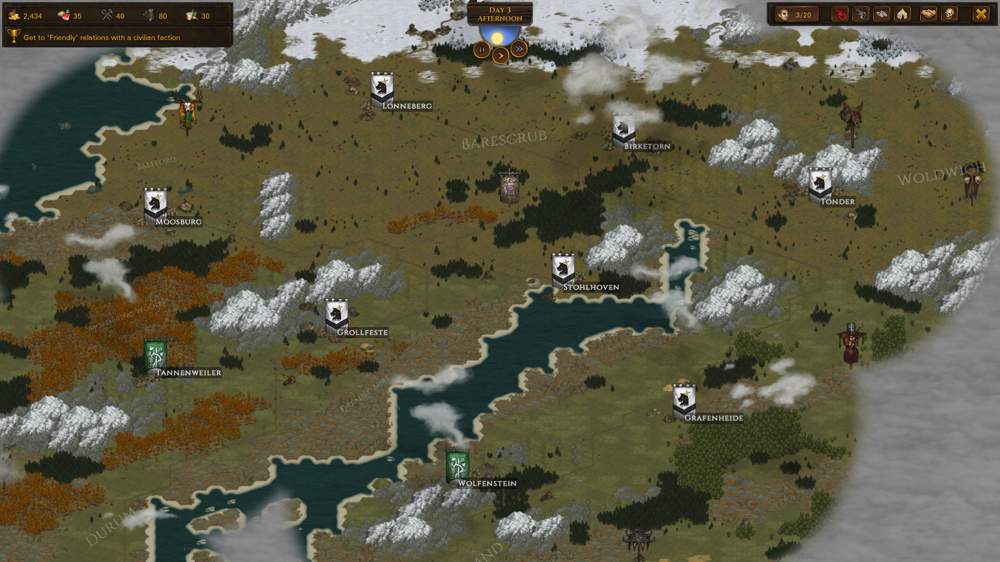
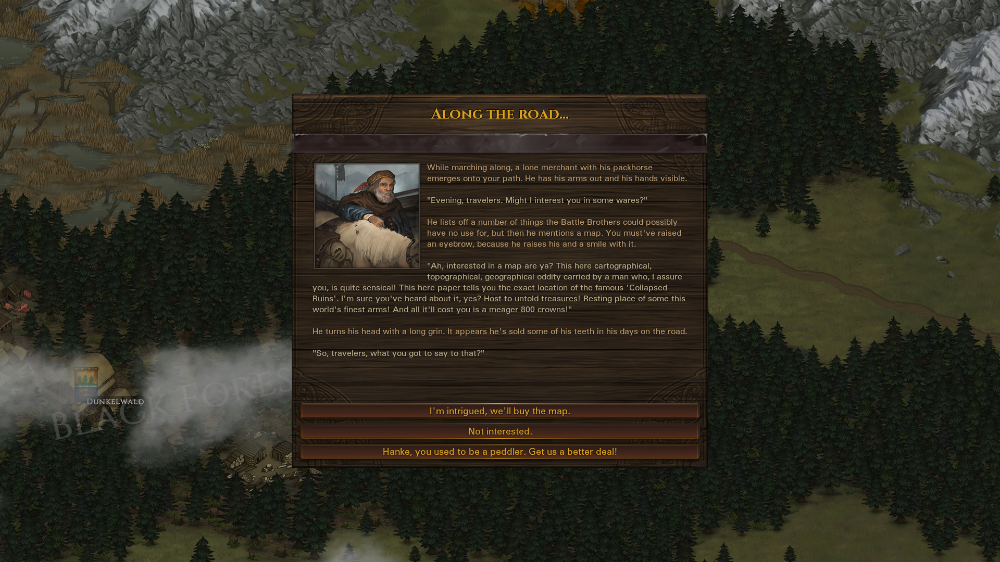
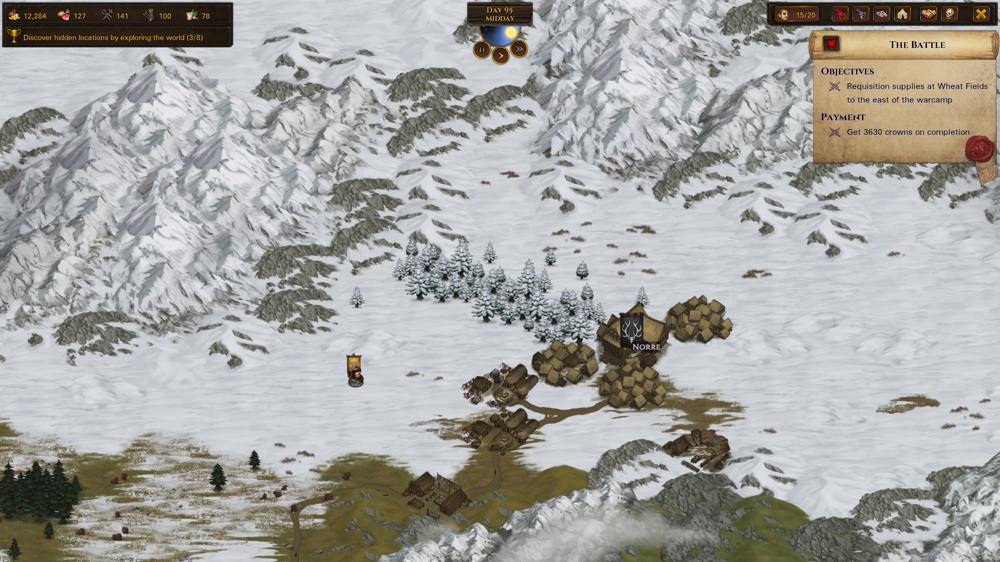

# Campaign: new game, world, contracts, events, save

Provenance: copied from `/home/jan/Sources/total-brothers/docs/battle-brothers-use-cases.md` SHA256 `0ccec5426118234ae18853aadaebf334de33eebbb097a323099b542f36e1ac87` (4418 lines, 330 `UC-*` ids, 77 `UNCONFIRMED` markers). This is a reusable player-loop catalog for a mercenary company, not a kingdom or Total War brief, and not a recovered numeric formula sheet. Authority and implementation are separate columns. Catalog confidence is not original-runtime confirmation. The local Battle Brothers install was not executed. Prototype screenshots from the old slice are rejected as original-game references.

Parity is not claimed for any row. Only `UC-COMBAT-065` has a separate static implementation note, and that note does not accept the catalog's 9 AP cost, perk gate, or full-turn claim.

Inspection frames linked here are official Steam store assets, analysis-only, not shipped game art. See [authentic reference](05-authentic-reference.md).

## Trace table

| ID | Title | Authority | Confidence | Implementation | Code | Tests | Next evidence |
| --- | --- | --- | --- | --- | --- | --- | --- |
| UC-META-001 | Start a new campaign from the main menu | public catalog copy, not recovered bytecode | catalog-stated, not runtime-confirmed | absent | gap | gap | native reference comparison; original runtime was not executed |
| UC-META-002 | Choose combat difficulty independently of economy | public catalog copy, not recovered bytecode | catalog-stated, not runtime-confirmed | absent | gap | gap | native reference comparison; original runtime was not executed |
| UC-META-003 | Choose economic difficulty | public catalog copy, not recovered bytecode | catalog-stated, not runtime-confirmed | absent | gap | gap | native reference comparison; original runtime was not executed |
| UC-META-004 | Starting resource table is visible before confirm | public catalog copy, not recovered bytecode | unconfirmed | absent | gap | gap | native reference comparison; original runtime was not executed |
| UC-META-005 | Toggle Ironman | public catalog copy, not recovered bytecode | catalog-stated, not runtime-confirmed | absent | gap | gap | native reference comparison; original runtime was not executed |
| UC-META-006 | Choose first late-game crisis or random or none | public catalog copy, not recovered bytecode | catalog-stated, not runtime-confirmed | absent | gap | gap | native reference comparison; original runtime was not executed |
| UC-META-007 | Optional map seed reproducibility | public catalog copy, not recovered bytecode | unconfirmed | absent | gap | gap | native reference comparison; original runtime was not executed |
| UC-META-008 | Procedural world contains northern houses and optional south | public catalog copy, not recovered bytecode | catalog-stated, not runtime-confirmed | absent | gap | gap | native reference comparison; original runtime was not executed |
| UC-META-009 | Fog of war initial reveal | public catalog copy, not recovered bytecode | unconfirmed | absent | gap | gap | native reference comparison; original runtime was not executed |
| UC-META-010 | Region labels on the world map | public catalog copy, not recovered bytecode | catalog-stated, not runtime-confirmed | absent | gap | gap | native reference comparison; original runtime was not executed |
| UC-META-011 | Permanent destruction option for crises | public catalog copy, not recovered bytecode | unconfirmed | absent | gap | gap | native reference comparison; original runtime was not executed |
| UC-META-012 | Combat difficulty delays crisis (Beginner) | public catalog copy, not recovered bytecode | unconfirmed | absent | gap | gap | native reference comparison; original runtime was not executed |
| UC-META-013 | Continue last campaign | public catalog copy, not recovered bytecode | catalog-stated, not runtime-confirmed | absent | gap | gap | native reference comparison; original runtime was not executed |
| UC-META-014 | Load a named slot (non-ironman) | public catalog copy, not recovered bytecode | catalog-stated, not runtime-confirmed | absent | gap | gap | native reference comparison; original runtime was not executed |
| UC-META-015 | Quit to menu without destroying Ironman progress | public catalog copy, not recovered bytecode | unconfirmed | absent | gap | gap | native reference comparison; original runtime was not executed |
| UC-META-016 | Difficulty does not change town inventories | public catalog copy, not recovered bytecode | catalog-stated, not runtime-confirmed | absent | gap | gap | native reference comparison; original runtime was not executed |
| UC-META-017 | Tutorial / first-run hints optional | public catalog copy, not recovered bytecode | unconfirmed | absent | gap | gap | native reference comparison; original runtime was not executed |
| UC-META-018 | Graphics/audio/gameplay options persist | public catalog copy, not recovered bytecode | catalog-stated, not runtime-confirmed | absent | gap | gap | native reference comparison; original runtime was not executed |
| UC-META-019 | Abandon campaign | public catalog copy, not recovered bytecode | catalog-stated, not runtime-confirmed | absent | gap | gap | native reference comparison; original runtime was not executed |
| UC-META-020 | Campaign calendar starts at day 1 | public catalog copy, not recovered bytecode | unconfirmed | absent | gap | gap | native reference comparison; original runtime was not executed |
| UC-META-021 | House procedural personality | public catalog copy, not recovered bytecode | catalog-stated, not runtime-confirmed | absent | gap | gap | native reference comparison; original runtime was not executed |
| UC-META-022 | City-state procedural personality | public catalog copy, not recovered bytecode | catalog-stated, not runtime-confirmed | absent | gap | gap | native reference comparison; original runtime was not executed |
| UC-META-023 | Wild faction camps placed off roads | public catalog copy, not recovered bytecode | catalog-stated, not runtime-confirmed | absent | gap | gap | native reference comparison; original runtime was not executed |
| UC-META-024 | Cannot change difficulty after start | public catalog copy, not recovered bytecode | catalog-stated, not runtime-confirmed | absent | gap | gap | native reference comparison; original runtime was not executed |
| UC-META-025 | Autosave on legal checkpoints | public catalog copy, not recovered bytecode | unconfirmed | absent | gap | gap | native reference comparison; original runtime was not executed |
| UC-WORLD-001 | Click-to-move the company | public catalog copy, not recovered bytecode | catalog-stated, not runtime-confirmed | absent | gap | gap | native reference comparison; original runtime was not executed |
| UC-WORLD-002 | Pause and unpause the world | public catalog copy, not recovered bytecode | catalog-stated, not runtime-confirmed | absent | gap | gap | native reference comparison; original runtime was not executed |
| UC-WORLD-003 | Time of day cycle | public catalog copy, not recovered bytecode | catalog-stated, not runtime-confirmed | absent | gap | gap | native reference comparison; original runtime was not executed |
| UC-WORLD-004 | Speed controls on the overworld | public catalog copy, not recovered bytecode | unconfirmed | absent | gap | gap | native reference comparison; original runtime was not executed |
| UC-WORLD-005 | Terrain speed, vision, and food multipliers | public catalog copy, not recovered bytecode | unconfirmed | absent | gap | gap | native reference comparison; original runtime was not executed |
| UC-WORLD-006 | Weather is mostly cosmetic on the world map | public catalog copy, not recovered bytecode | catalog-stated, not runtime-confirmed | absent | gap | gap | native reference comparison; original runtime was not executed |
| UC-WORLD-007 | Vision radius, hills, night, lookout | public catalog copy, not recovered bytecode | catalog-stated, not runtime-confirmed | absent | gap | gap | native reference comparison; original runtime was not executed |
| UC-WORLD-008 | Explored tiles stay revealed | public catalog copy, not recovered bytecode | unconfirmed | absent | gap | gap | native reference comparison; original runtime was not executed |
| UC-WORLD-009 | Footprints / tracking toggle | public catalog copy, not recovered bytecode | unconfirmed | absent | gap | gap | native reference comparison; original runtime was not executed |
| UC-WORLD-010 | Other parties move in real time | public catalog copy, not recovered bytecode | catalog-stated, not runtime-confirmed | absent | gap | gap | native reference comparison; original runtime was not executed |
| UC-WORLD-011 | Tooltip on a party before engaging | public catalog copy, not recovered bytecode | catalog-stated, not runtime-confirmed | absent | gap | gap | native reference comparison; original runtime was not executed |
| UC-WORLD-012 | Intercept / engage a hostile party | public catalog copy, not recovered bytecode | catalog-stated, not runtime-confirmed | absent | gap | gap | native reference comparison; original runtime was not executed |
| UC-WORLD-013 | Attack a neutral party (explicit hostile action) | public catalog copy, not recovered bytecode | catalog-stated, not runtime-confirmed | absent | gap | gap | native reference comparison; original runtime was not executed |
| UC-WORLD-014 | Discover a location in the wild | public catalog copy, not recovered bytecode | catalog-stated, not runtime-confirmed | absent | gap | gap | native reference comparison; original runtime was not executed |
| UC-WORLD-015 | Raid a hostile location | public catalog copy, not recovered bytecode | catalog-stated, not runtime-confirmed | absent | gap | gap | native reference comparison; original runtime was not executed |
| UC-WORLD-016 | Defend a location when roles reverse | public catalog copy, not recovered bytecode | catalog-stated, not runtime-confirmed | absent | gap | gap | native reference comparison; original runtime was not executed |
| UC-WORLD-017 | Enter a settlement | public catalog copy, not recovered bytecode | catalog-stated, not runtime-confirmed | absent | gap | gap | native reference comparison; original runtime was not executed |
| UC-WORLD-018 | Sea travel between ports | public catalog copy, not recovered bytecode | unconfirmed | absent | gap | gap | native reference comparison; original runtime was not executed |
| UC-WORLD-019 | Roads vs wilderness pathing | public catalog copy, not recovered bytecode | unconfirmed | absent | gap | gap | native reference comparison; original runtime was not executed |
| UC-WORLD-020 | Ambush risk in concealment terrain | public catalog copy, not recovered bytecode | unconfirmed | absent | gap | gap | native reference comparison; original runtime was not executed |
| UC-WORLD-021 | Chase on the world map | public catalog copy, not recovered bytecode | unconfirmed | absent | gap | gap | native reference comparison; original runtime was not executed |
| UC-WORLD-022 | Contract target gold-coin marker | public catalog copy, not recovered bytecode | catalog-stated, not runtime-confirmed | absent | gap | gap | native reference comparison; original runtime was not executed |
| UC-WORLD-023 | Famed-item rumour pins a vague direction | public catalog copy, not recovered bytecode | catalog-stated, not runtime-confirmed | absent | gap | gap | native reference comparison; original runtime was not executed |
| UC-WORLD-024 | Day/night affects tactical battles launched now | public catalog copy, not recovered bytecode | unconfirmed | absent | gap | gap | native reference comparison; original runtime was not executed |
| UC-WORLD-025 | Food spoilage while travelling | public catalog copy, not recovered bytecode | catalog-stated, not runtime-confirmed | absent | gap | gap | native reference comparison; original runtime was not executed |
| UC-WORLD-026 | Repair and healing ticks on the road | public catalog copy, not recovered bytecode | catalog-stated, not runtime-confirmed | absent | gap | gap | native reference comparison; original runtime was not executed |
| UC-WORLD-027 | Wages tick daily | public catalog copy, not recovered bytecode | catalog-stated, not runtime-confirmed | absent | gap | gap | native reference comparison; original runtime was not executed |
| UC-WORLD-028 | Renown slowly decays | public catalog copy, not recovered bytecode | unconfirmed | absent | gap | gap | native reference comparison; original runtime was not executed |
| UC-WORLD-029 | Camera pan/zoom/center on company | public catalog copy, not recovered bytecode | unconfirmed | absent | gap | gap | native reference comparison; original runtime was not executed |
| UC-WORLD-030 | Relations window from the world map | public catalog copy, not recovered bytecode | catalog-stated, not runtime-confirmed | absent | gap | gap | native reference comparison; original runtime was not executed |
| UC-WORLD-031 | Other mercenary companies compete for contracts | public catalog copy, not recovered bytecode | catalog-stated, not runtime-confirmed | absent | gap | gap | native reference comparison; original runtime was not executed |
| UC-WORLD-032 | Caravans change settlement supply | public catalog copy, not recovered bytecode | unconfirmed | absent | gap | gap | native reference comparison; original runtime was not executed |
| UC-WORLD-033 | Legendary / unique wilderness sites | public catalog copy, not recovered bytecode | catalog-stated, not runtime-confirmed | absent | gap | gap | native reference comparison; original runtime was not executed |
| UC-WORLD-034 | World-map retreat after a lost field battle | public catalog copy, not recovered bytecode | catalog-stated, not runtime-confirmed | absent | gap | gap | native reference comparison; original runtime was not executed |
| UC-CONTRACT-001 | Browse a settlement contract board | public catalog copy, not recovered bytecode | catalog-stated, not runtime-confirmed | absent | gap | gap | native reference comparison; original runtime was not executed |
| UC-CONTRACT-002 | Only one contract at a time | public catalog copy, not recovered bytecode | catalog-stated, not runtime-confirmed | absent | gap | gap | native reference comparison; original runtime was not executed |
| UC-CONTRACT-003 | Negotiation dialog | public catalog copy, not recovered bytecode | unconfirmed | absent | gap | gap | native reference comparison; original runtime was not executed |
| UC-CONTRACT-004 | Haggle for more pay — annoyance hidden state | public catalog copy, not recovered bytecode | catalog-stated, not runtime-confirmed | absent | gap | gap | native reference comparison; original runtime was not executed |
| UC-CONTRACT-005 | Ask for payment in advance | public catalog copy, not recovered bytecode | catalog-stated, not runtime-confirmed | absent | gap | gap | native reference comparison; original runtime was not executed |
| UC-CONTRACT-006 | Ask for per-head pay | public catalog copy, not recovered bytecode | catalog-stated, not runtime-confirmed | absent | gap | gap | native reference comparison; original runtime was not executed |
| UC-CONTRACT-007 | Renown gates pay and house contracts | public catalog copy, not recovered bytecode | catalog-stated, not runtime-confirmed | absent | gap | gap | native reference comparison; original runtime was not executed |
| UC-CONTRACT-008 | Relations gate offers and prices | public catalog copy, not recovered bytecode | catalog-stated, not runtime-confirmed | absent | gap | gap | native reference comparison; original runtime was not executed |
| UC-CONTRACT-009 | Complete a contract | public catalog copy, not recovered bytecode | catalog-stated, not runtime-confirmed | absent | gap | gap | native reference comparison; original runtime was not executed |
| UC-CONTRACT-010 | Fail, cancel, or betray a contract | public catalog copy, not recovered bytecode | catalog-stated, not runtime-confirmed | absent | gap | gap | native reference comparison; original runtime was not executed |
| UC-CONTRACT-011 | Escort caravan | public catalog copy, not recovered bytecode | catalog-stated, not runtime-confirmed | absent | gap | gap | native reference comparison; original runtime was not executed |
| UC-CONTRACT-012 | Deliver item / mail | public catalog copy, not recovered bytecode | catalog-stated, not runtime-confirmed | absent | gap | gap | native reference comparison; original runtime was not executed |
| UC-CONTRACT-013 | Hunting bandits / beasts / marauders | public catalog copy, not recovered bytecode | unconfirmed | absent | gap | gap | native reference comparison; original runtime was not executed |
| UC-CONTRACT-014 | Investigate / patrol / find a location | public catalog copy, not recovered bytecode | catalog-stated, not runtime-confirmed | absent | gap | gap | native reference comparison; original runtime was not executed |
| UC-CONTRACT-015 | Defend a settlement or fort | public catalog copy, not recovered bytecode | catalog-stated, not runtime-confirmed | absent | gap | gap | native reference comparison; original runtime was not executed |
| UC-CONTRACT-016 | Raid / burn / steal for a house | public catalog copy, not recovered bytecode | catalog-stated, not runtime-confirmed | absent | gap | gap | native reference comparison; original runtime was not executed |
| UC-CONTRACT-017 | Siege / great battle / relieve siege (civil war) | public catalog copy, not recovered bytecode | catalog-stated, not runtime-confirmed | absent | gap | gap | native reference comparison; original runtime was not executed |
| UC-CONTRACT-018 | Holy-war contracts (north vs city-states) | public catalog copy, not recovered bytecode | catalog-stated, not runtime-confirmed | absent | gap | gap | native reference comparison; original runtime was not executed |
| UC-CONTRACT-019 | Obtain / destroy a greenskin siege engine (invasion) | public catalog copy, not recovered bytecode | unconfirmed | absent | gap | gap | native reference comparison; original runtime was not executed |
| UC-CONTRACT-020 | Undead crisis contracts | public catalog copy, not recovered bytecode | catalog-stated, not runtime-confirmed | absent | gap | gap | native reference comparison; original runtime was not executed |
| UC-CONTRACT-021 | Arena match as a contract-like activity | public catalog copy, not recovered bytecode | unconfirmed | absent | gap | gap | native reference comparison; original runtime was not executed |
| UC-CONTRACT-022 | Civilian vs house vs city-state employers | public catalog copy, not recovered bytecode | catalog-stated, not runtime-confirmed | absent | gap | gap | native reference comparison; original runtime was not executed |
| UC-CONTRACT-023 | Time limits | public catalog copy, not recovered bytecode | catalog-stated, not runtime-confirmed | absent | gap | gap | native reference comparison; original runtime was not executed |
| UC-CONTRACT-024 | Contract events while active | public catalog copy, not recovered bytecode | catalog-stated, not runtime-confirmed | absent | gap | gap | native reference comparison; original runtime was not executed |
| UC-CONTRACT-025 | Payment summary is auditable | public catalog copy, not recovered bytecode | catalog-stated, not runtime-confirmed | absent | gap | gap | native reference comparison; original runtime was not executed |
| UC-CONTRACT-026 | Cannot attack protected contract parties | public catalog copy, not recovered bytecode | catalog-stated, not runtime-confirmed | absent | gap | gap | native reference comparison; original runtime was not executed |
| UC-CONTRACT-027 | Return-to-employer hand-in | public catalog copy, not recovered bytecode | catalog-stated, not runtime-confirmed | absent | gap | gap | native reference comparison; original runtime was not executed |
| UC-EVENT-001 | Road event fires and pauses the world | public catalog copy, not recovered bytecode | catalog-stated, not runtime-confirmed | absent | gap | gap | native reference comparison; original runtime was not executed |
| UC-EVENT-002 | Event requirements are data | public catalog copy, not recovered bytecode | catalog-stated, not runtime-confirmed | absent | gap | gap | native reference comparison; original runtime was not executed |
| UC-EVENT-003 | Ambition selection | public catalog copy, not recovered bytecode | catalog-stated, not runtime-confirmed | absent | gap | gap | native reference comparison; original runtime was not executed |
| UC-EVENT-004 | Battle standard ambition | public catalog copy, not recovered bytecode | catalog-stated, not runtime-confirmed | absent | gap | gap | native reference comparison; original runtime was not executed |
| UC-EVENT-005 | Make nobles aware / professional threshold | public catalog copy, not recovered bytecode | catalog-stated, not runtime-confirmed | absent | gap | gap | native reference comparison; original runtime was not executed |
| UC-EVENT-006 | Crisis foreshadowing then phase 2 | public catalog copy, not recovered bytecode | catalog-stated, not runtime-confirmed | absent | gap | gap | native reference comparison; original runtime was not executed |
| UC-EVENT-007 | Civil war crisis behaviour | public catalog copy, not recovered bytecode | catalog-stated, not runtime-confirmed | absent | gap | gap | native reference comparison; original runtime was not executed |
| UC-EVENT-008 | Greenskin invasion crisis | public catalog copy, not recovered bytecode | catalog-stated, not runtime-confirmed | absent | gap | gap | native reference comparison; original runtime was not executed |
| UC-EVENT-009 | Undead scourge crisis | public catalog copy, not recovered bytecode | catalog-stated, not runtime-confirmed | absent | gap | gap | native reference comparison; original runtime was not executed |
| UC-EVENT-010 | Holy war crisis | public catalog copy, not recovered bytecode | catalog-stated, not runtime-confirmed | absent | gap | gap | native reference comparison; original runtime was not executed |
| UC-EVENT-011 | Resolving a crisis and the next one | public catalog copy, not recovered bytecode | catalog-stated, not runtime-confirmed | absent | gap | gap | native reference comparison; original runtime was not executed |
| UC-EVENT-012 | Relations decay and recovery | public catalog copy, not recovered bytecode | catalog-stated, not runtime-confirmed | absent | gap | gap | native reference comparison; original runtime was not executed |
| UC-EVENT-013 | Food variety events | public catalog copy, not recovered bytecode | catalog-stated, not runtime-confirmed | absent | gap | gap | native reference comparison; original runtime was not executed |
| UC-EVENT-014 | Crisis-only recruits | public catalog copy, not recovered bytecode | catalog-stated, not runtime-confirmed | absent | gap | gap | native reference comparison; original runtime was not executed |
| UC-SAVE-001 | Manual save (non-ironman) | public catalog copy, not recovered bytecode | catalog-stated, not runtime-confirmed | absent | gap | gap | native reference comparison; original runtime was not executed |
| UC-SAVE-002 | Ironman single slot | public catalog copy, not recovered bytecode | catalog-stated, not runtime-confirmed | absent | gap | gap | native reference comparison; original runtime was not executed |
| UC-SAVE-003 | Defeat — company destroyed | public catalog copy, not recovered bytecode | catalog-stated, not runtime-confirmed | absent | gap | gap | native reference comparison; original runtime was not executed |
| UC-SAVE-004 | Optional retirement (victory-ish closure) | public catalog copy, not recovered bytecode | catalog-stated, not runtime-confirmed | absent | gap | gap | native reference comparison; original runtime was not executed |
| UC-SAVE-005 | There is no win-the-map condition | public catalog copy, not recovered bytecode | catalog-stated, not runtime-confirmed | absent | gap | gap | native reference comparison; original runtime was not executed |
| UC-SAVE-006 | Permadeath of brothers vs campaign | public catalog copy, not recovered bytecode | catalog-stated, not runtime-confirmed | absent | gap | gap | native reference comparison; original runtime was not executed |
| UC-SAVE-007 | Save contains full world RNG state | public catalog copy, not recovered bytecode | catalog-stated, not runtime-confirmed | absent | gap | gap | native reference comparison; original runtime was not executed |
| UC-CONTRACT-028 | Drive away / destroy a beast lair | public catalog copy, not recovered bytecode | catalog-stated, not runtime-confirmed | absent | gap | gap | native reference comparison; original runtime was not executed |
| UC-CONTRACT-029 | Obtain a personal item / heirlooms | public catalog copy, not recovered bytecode | catalog-stated, not runtime-confirmed | absent | gap | gap | native reference comparison; original runtime was not executed |
| UC-CONTRACT-030 | Short patrol around a town | public catalog copy, not recovered bytecode | catalog-stated, not runtime-confirmed | absent | gap | gap | native reference comparison; original runtime was not executed |
| UC-CONTRACT-031 | Intercept a specific party | public catalog copy, not recovered bytecode | catalog-stated, not runtime-confirmed | absent | gap | gap | native reference comparison; original runtime was not executed |
| UC-CONTRACT-032 | False-flag / intrigue job | public catalog copy, not recovered bytecode | catalog-stated, not runtime-confirmed | absent | gap | gap | native reference comparison; original runtime was not executed |
| UC-CONTRACT-033 | Slave-catch / indebted capture (manhunter-adjacent) | public catalog copy, not recovered bytecode | catalog-stated, not runtime-confirmed | absent | gap | gap | native reference comparison; original runtime was not executed |
| UC-CONTRACT-034 | Holy site defend (waves) | public catalog copy, not recovered bytecode | catalog-stated, not runtime-confirmed | absent | gap | gap | native reference comparison; original runtime was not executed |
| UC-CONTRACT-035 | Rival mercenaries offer to switch sides | public catalog copy, not recovered bytecode | catalog-stated, not runtime-confirmed | absent | gap | gap | native reference comparison; original runtime was not executed |
| UC-CONTRACT-036 | Return to report after investigating a cemetery / ruin | public catalog copy, not recovered bytecode | catalog-stated, not runtime-confirmed | absent | gap | gap | native reference comparison; original runtime was not executed |
| UC-CONTRACT-037 | Early tutorial hunt (rebuilding origin) | public catalog copy, not recovered bytecode | catalog-stated, not runtime-confirmed | absent | gap | gap | native reference comparison; original runtime was not executed |
| UC-EVENT-015 | Ambition: destroy goblin/undead locations | public catalog copy, not recovered bytecode | catalog-stated, not runtime-confirmed | absent | gap | gap | native reference comparison; original runtime was not executed |
| UC-EVENT-016 | Ambition: defeat another mercenary company | public catalog copy, not recovered bytecode | catalog-stated, not runtime-confirmed | absent | gap | gap | native reference comparison; original runtime was not executed |
| UC-EVENT-017 | Ambition: win vs 12+ enemies | public catalog copy, not recovered bytecode | catalog-stated, not runtime-confirmed | absent | gap | gap | native reference comparison; original runtime was not executed |
| UC-EVENT-018 | Retirement score uses days as divisor | public catalog copy, not recovered bytecode | catalog-stated, not runtime-confirmed | absent | gap | gap | native reference comparison; original runtime was not executed |

## Scenarios

Preconditions, main flows, alternate and exception flows, and observable results are copied. `UNCONFIRMED` markers are kept.

### UC-META-001 — Start a new campaign from the main menu

**Tags:** `meta`
**Actor:** Player
**Precondition:** Main menu is showing; no campaign is loaded.
**Main flow:**
1. Player selects New Campaign.
2. System presents campaign customization: difficulty axes, ironman toggle, first late-game crisis preference, optional map seed, banner, origin.
3. Player confirms.
4. System generates a world and drops the company onto it.
**Alternate / exception flows:**
- Player cancels: returns to main menu with no save created.
- Invalid/unsupported seed format: reject with a clear error; do not silently substitute.
**Observable result:** A new campaign begins on a generated world map with the chosen settings persisted on the save.

### UC-META-002 — Choose combat difficulty independently of economy

**Tags:** `meta | combat | economy`
**Actor:** Player
**Precondition:** New campaign screen is open.
**Main flow:**
1. Player sets Combat difficulty (Beginner / Veteran / Expert or equivalent three-tier labels).
2. Tooltip states effects: harder enemy groups appear sooner on higher tiers; Beginner grants a small player to-hit advantage and enemy to-hit penalty (reference: ±5 on to-hit rolls).
3. Player can set Economic difficulty to a different tier.
**Alternate / exception flows:**
- Changing combat difficulty does not silently change starting gold.
- Enemy equipment quality is NOT scaled by difficulty (reference: same gear stats across difficulties).
**Observable result:** UI shows two independent difficulty axes with tooltips. Starting a campaign stores both values.

### UC-META-003 — Choose economic difficulty

**Tags:** `meta | economy`
**Actor:** Player
**Precondition:** New campaign screen is open.
**Main flow:**
1. Player sets Economic difficulty.
2. Tooltip states: higher tiers pay less for contracts (~10% less per step in the reference), reduce sell prices on Expert, change supply caps, and on Expert deserters keep their gear.
3. Starting funds table is shown for High/Medium/Low starting resources.
**Alternate / exception flows:**
- Beginner increases max ammo/tools/medicine carry caps (reference: +200 ammo, +50 tools, +50 medicine).
- If origin overrides starting funds, origin wins and the tooltip says so.
**Observable result:** Tester sees contract-pay and stash-cap implications before confirming.

### UC-META-004 — Starting resource table is visible before confirm

**Tags:** `meta | economy | company`
**Actor:** Player
**Precondition:** Difficulty set; origin selected.
**Main flow:**
1. UI shows starting crowns, provisions, tools, ammo, medicine for the selected economic tier.
2. Reference vanilla defaults (before origin modifiers): High 2500/50/40/80/30; Medium 2000/50/20/40/20; Low 1500/50/10/20/10.
**Alternate / exception flows:**
- Origin that starts poorer or richer updates the preview immediately.
- UNCONFIRMED: exact origin modifiers per DLC origin — lock in a data table.
**Observable result:** Confirming the campaign grants exactly the previewed numbers.

### UC-META-005 — Toggle Ironman

**Tags:** `meta`
**Actor:** Player
**Precondition:** New campaign screen.
**Main flow:**
1. Player enables Ironman.
2. Tooltip: game autosaves; player cannot create manual save points; only the latest autosave exists; every decision is final.
3. Player starts the campaign.
**Alternate / exception flows:**
- Ironman + Beginner combat each delay the first late crisis by ~5 days in the reference — show this in tooltip.
- Quit-without-save (Alt+F4 analogue) is a known ironman abort; do not offer a 'save and quit' that creates a second slot.
- If Ironman is off, F5/F9 style quicksave/quickload is available later.
**Observable result:** Save UI for an Ironman campaign hides manual save slots and only rotates one autosave.

### UC-META-006 — Choose first late-game crisis or random or none

**Tags:** `meta | overworld`
**Actor:** Player
**Precondition:** New campaign customization.
**Main flow:**
1. Player picks first crisis: Random (default), Noble civil war, Greenskin invasion, Undead scourge, Holy war (if southern content enabled), or None.
2. Tooltip explains that a crisis is a late-game world event with unique contracts, not an instant lose timer.
**Alternate / exception flows:**
- None: no late crisis fires (sandbox).
- Random: player cannot prepare a specific enemy type from day 1.
- Same crisis does not repeat immediately after resolution (reference).
**Observable result:** Chosen preference is stored. Foreshadowing events later match it (or a random legal crisis).

### UC-META-007 — Optional map seed reproducibility

**Tags:** `meta | overworld`
**Actor:** Player
**Precondition:** New campaign screen offers a seed field.
**Main flow:**
1. Player enters a seed (or leaves blank for random).
2. System generates geography, settlements, houses, and static location layout from the seed.
**Alternate / exception flows:**
- Same seed + same generation version + same DLC flags → same map layout and named-item location rolls (reference).
- Changing origin or difficulty should not reshape continents; UNCONFIRMED whether origin starting region is seed-relative.
- If generator version changes, UI warns that old seeds may not match.
**Observable result:** Two campaigns with identical seed and generator version produce matching coastlines and settlement graphs.

### UC-META-008 — Procedural world contains northern houses and optional south

**Tags:** `meta | overworld`
**Actor:** System
**Precondition:** World generation runs.
**Main flow:**
1. Generator places a continent with climate bands (plains, forest, swamp, hills, mountains, tundra/snow, coast, optional desert/steppe).
2. Places three northern noble houses with unique heraldry, traits (e.g. warmonger vs schemer archetypes), and fief lists.
3. If southern content is on, places city-states around water in the desert belt.
4. Places roads, ports, and wild locations (camps, ruins) under fog.
**Alternate / exception flows:**
- Settlement count in a typical northern-only map is on the order of ~17 mixed villages/towns/castles (reference typical mix). Treat as a generation target, not a hard law.
- House settlement split can be even or lopsided.
**Observable result:** Loading the world map shows multiple human factions, roads, and unexplored wilderness.

### UC-META-009 — Fog of war initial reveal

**Tags:** `meta | overworld`
**Actor:** System
**Precondition:** Campaign just created.
**Main flow:**
1. Tiles around human settlements and the roads between them start revealed.
2. Wilderness, hostile camps, and legendary sites start hidden.
3. Player vision circle around the company is revealed and stays explored once seen.
**Alternate / exception flows:**
- Forest and similar terrain can hide parties until closer (ambush risk).
- Clearing fog is not the same as scouting a hidden location — player may need to walk closer to spawn/reveal a camp. UNCONFIRMED exact radii.
**Observable result:** Tester sees a mostly-fogged wild with lit settlement corridors.

### UC-META-010 — Region labels on the world map

**Tags:** `meta | overworld | ui`
**Actor:** Player
**Precondition:** World exists.
**Main flow:**
1. Large terrain regions display generated names (player-facing cartography).
2. Names persist for the campaign.
**Alternate / exception flows:**
- Zoomed-out map remains readable; names do not cover settlement icons at default zoom.
**Observable result:** Tester can identify named regions without opening a legend.

### UC-META-011 — Permanent destruction option for crises

**Tags:** `meta | overworld`
**Actor:** Player
**Precondition:** New campaign options include settlement destruction.
**Main flow:**
1. Player enables or disables permanent destruction of settlements by greenskin/undead-style crises.
2. If off, threatened towns get lasting negative situations instead of vanishing.
**Alternate / exception flows:**
- Civil war captures towns rather than razing them regardless of this flag (reference).
- UNCONFIRMED: exact option label in vanilla vs mods.
**Observable result:** During a destructive crisis, towns either ruin permanently or only suffer situations, matching the flag.

### UC-META-012 — Combat difficulty delays crisis (Beginner)

**Tags:** `meta`
**Actor:** System
**Precondition:** Beginner combat and/or Ironman enabled.
**Main flow:**
1. First late crisis is delayed by about 5 days per such flag (reference).
**Alternate / exception flows:**
- Stacking both delays ~10 days. UNCONFIRMED if more flags stack.
**Observable result:** A calendar-instrumented test sees crisis foreshadowing later than a Veteran non-ironman run with the same seed.

### UC-META-013 — Continue last campaign

**Tags:** `meta`
**Actor:** Player
**Precondition:** At least one save exists.
**Main flow:**
1. Player selects Continue.
2. Most recently played save loads.
**Alternate / exception flows:**
- Ironman Continue loads the only autosave.
- Corrupt save: error, do not crash; offer another slot if any.
**Observable result:** Player is on the world map at the stored time and position.

### UC-META-014 — Load a named slot (non-ironman)

**Tags:** `meta`
**Actor:** Player
**Precondition:** Non-ironman campaign with multiple slots.
**Main flow:**
1. Player opens Load, picks a slot, confirms.
**Alternate / exception flows:**
- Ironman campaigns do not appear as multi-slot lists.
**Observable result:** World, roster, stash, contracts, and calendar match that slot.

### UC-META-015 — Quit to menu without destroying Ironman progress

**Tags:** `meta`
**Actor:** Player
**Precondition:** Ironman campaign, last autosave is current.
**Main flow:**
1. Player quits via the menu (which autosaved on last legal checkpoint).
2. Continue restores that checkpoint.
**Alternate / exception flows:**
- Force-kill of the process may lose time since last autosave — document autosave triggers (enter/leave settlement, after combat, after event, periodic). UNCONFIRMED exact trigger list.
**Observable result:** No extra slot is created; Continue works.

### UC-META-016 — Difficulty does not change town inventories

**Tags:** `meta | economy`
**Actor:** System
**Precondition:** Two campaigns same seed different combat difficulty.
**Main flow:**
1. Marketplace item availability is independent of combat difficulty (reference).
**Alternate / exception flows:**
- Economic difficulty still changes prices and caps.
**Observable result:** QA comparing shops sees the same stock lists, different prices if economy tier differs.

### UC-META-017 — Tutorial / first-run hints optional

**Tags:** `meta | ui`
**Actor:** Player
**Precondition:** First launch or new campaign.
**Main flow:**
1. Player can enable loading-screen / tooltip hints.
2. Hints never block input on the world map except an optional first-contract coach.
**Alternate / exception flows:**
- UNCONFIRMED: vanilla has loading tips, not a full tutorial campaign.
**Observable result:** A veteran can start with hints off.

### UC-META-018 — Graphics/audio/gameplay options persist

**Tags:** `meta | ui`
**Actor:** Player
**Precondition:** Options menu.
**Main flow:**
1. Player sets resolution, fullscreen, volume buses, autosave, auto-end-turn, combat speed, camera shake.
2. Settings persist across sessions.
**Alternate / exception flows:**
- Gameplay option 'auto-end turn when AP=0' can be disabled.
**Observable result:** Relaunch restores options.

### UC-META-019 — Abandon campaign

**Tags:** `meta`
**Actor:** Player
**Precondition:** A save exists.
**Main flow:**
1. Player deletes/abandons a campaign from load menu with a confirm dialog.
**Alternate / exception flows:**
- Ironman delete is allowed; confirm copy is stronger.
**Observable result:** That slot is gone; other slots untouched.

### UC-META-020 — Campaign calendar starts at day 1

**Tags:** `meta | overworld`
**Actor:** System
**Precondition:** New campaign created.
**Main flow:**
1. World clock starts at a defined time of day (often morning). Day counter = 1.
2. Wages will first tick at noon/afternoon of a day as designed.
**Alternate / exception flows:**
- UNCONFIRMED exact starting hour.
**Observable result:** HUD clock shows day 1 and a day-phase icon.

### UC-META-021 — House procedural personality

**Tags:** `meta | overworld | economy`
**Actor:** System
**Precondition:** Worldgen.
**Main flow:**
1. Each northern house gets a coat of arms, generated leaders, and behavioural traits that bias the contracts they offer (war vs intrigue archetypes).
**Alternate / exception flows:**
- Traits are data-driven; flavour text is original, not copied.
**Observable result:** Relations screen shows three distinct houses with different mottos/traits.

### UC-META-022 — City-state procedural personality

**Tags:** `meta | overworld`
**Actor:** System
**Precondition:** Southern content enabled.
**Main flow:**
1. City-states generate as wealth-ruled urban factions with bazaars, distinct architecture tags, and their own contract pool.
**Alternate / exception flows:**
- If southern content disabled, no desert belt / no holy-war crisis option.
**Observable result:** Map shows a climatic south with urban factions distinct from northern fiefs.

### UC-META-023 — Wild faction camps placed off roads

**Tags:** `meta | overworld`
**Actor:** System
**Precondition:** Worldgen.
**Main flow:**
1. Hostile camps (brigands, beasts, greenskins, undead, southern raiders, etc.) spawn in valid biomes at a distance from towns.
2. They remain hidden until scouted.
**Alternate / exception flows:**
- Camp size and distance from civilisation increase chance of famed loot (reference).
**Observable result:** Exploring fog reveals camps that were not visible at start.

### UC-META-024 — Cannot change difficulty after start

**Tags:** `meta`
**Actor:** Player
**Precondition:** Campaign running.
**Main flow:**
1. Options menu has no combat/economy difficulty rewrite for the active save.
**Alternate / exception flows:**
- A debug/cheat flag may exist for developers but is not a player control.
**Observable result:** The campaign's locked difficulties display as read-only in a campaign info panel.

### UC-META-025 — Autosave on legal checkpoints

**Tags:** `meta`
**Actor:** System
**Precondition:** Campaign in progress.
**Main flow:**
1. System writes autosave after: finishing combat, closing a resolved event, entering/leaving a settlement, accepting/failing a contract, and on a timer while travelling. UNCONFIRMED exact set — treat as design lock.
2. Ironman overwrites the only slot.
**Alternate / exception flows:**
- Do not autosave mid-event choice or mid-turn in combat in a way that allows scumming a roll by force-quit — if a roll already resolved, it is committed.
**Observable result:** Force-quit after a finished battle restores post-battle state, not pre-battle.
---

### UC-WORLD-001 — Click-to-move the company

**Tags:** `overworld`
**Actor:** Player
**Precondition:** World map, unpaused or paused.
**Main flow:**
1. Player left-clicks a walkable tile or settlement.
2. Company pathfinds along roads when beneficial, off-road otherwise.
3. Movement speed depends on terrain multipliers.
**Alternate / exception flows:**
- Clicking water without a port does nothing.
- Mountains are very slow (reference ~0.25 speed, 2× food).
- Pause does not cancel an existing path.
**Observable result:** Figurine walks the path; ETA can be inferred from clock motion.

### UC-WORLD-002 — Pause and unpause the world

**Tags:** `overworld | ui`
**Actor:** Player
**Precondition:** On world map.
**Main flow:**
1. Player presses Space (or pause button).
2. Clock, movement of all parties, food drip, repair ticks freeze.
3. Unpause resumes.
**Alternate / exception flows:**
- Opening inventory/relations may auto-pause (design lock). Reference: time also halted in town, events, combat.
**Observable result:** Clock icon shows paused; AI parties do not move.

### UC-WORLD-003 — Time of day cycle

**Tags:** `overworld | combat`
**Actor:** System
**Precondition:** Clock running.
**Main flow:**
1. Day phases cycle: Dawn, Morning, Midday, Afternoon, Evening, Dusk, Night.
2. A full in-game day is on the order of ~1 minute 45 seconds real time at 1× (reference).
3. Night slows travel and reduces sight radius.
**Alternate / exception flows:**
- Wages pay when Afternoon starts / at noon (reference: wages at noon when Afternoon starts).
- Most settlement services close at night; tavern stays open; hiring is closed at night.
**Observable result:** HUD phase icon changes; night visibly darkens the map and shrinks vision.

### UC-WORLD-004 — Speed controls on the overworld

**Tags:** `overworld | ui`
**Actor:** Player
**Precondition:** World map.
**Main flow:**
1. Player can set 1× and at least one faster speed (and pause).
2. Faster speed accelerates party movement, clock, and background ticks equally.
**Alternate / exception flows:**
- UNCONFIRMED exact speed steps in vanilla (commonly pause / play / fast).
- Combat has its own speed; do not couple them.
**Observable result:** Holding fast-forward makes a multi-day trip complete quickly while ticks remain correct.

### UC-WORLD-005 — Terrain speed, vision, and food multipliers

**Tags:** `overworld | economy`
**Actor:** System
**Precondition:** Company moving.
**Main flow:**
1. Apply per-terrain modifiers. Reference table (design lock): plains/farmland/steppe speed 1 vision 1 food 1 (steppe food 1.1); tundra 0.9/1/1; oasis 0.9/1/1; badlands 0.9/1/1.25; snow 0.75/1/1.1; desert 0.75/1/1.5; forest 0.65/1/1; snowy forest 0.65/1/1.1; hills 0.65/1.25/1.1; shore 0.5/1/1; swamp 0.5/1/1.1; mountains 0.25/2/2.
**Alternate / exception flows:**
- Roads improve speed relative to surrounding terrain. UNCONFIRMED exact road bonus.
- Retinue Scout +15% move speed stacks after terrain (reference).
**Observable result:** Crossing mountains visibly crawls and burns more food than plains.

### UC-WORLD-006 — Weather is mostly cosmetic on the world map

**Tags:** `overworld`
**Actor:** System
**Precondition:** Company in tundra/north.
**Main flow:**
1. Light snow or storms may play as VFX.
2. Reference wiki: weather effects are purely cosmetic as of the cited version.
**Alternate / exception flows:**
- If the clone later adds mechanical storms, mark as a deviation.
- Night is mechanical; weather is not (vanilla).
**Observable result:** Snow VFX can play without changing path speed beyond the snow terrain tile itself.

### UC-WORLD-007 — Vision radius, hills, night, lookout

**Tags:** `overworld`
**Actor:** Player
**Precondition:** Company on map.
**Main flow:**
1. Base vision reveals tiles and parties.
2. Hills/mountains increase vision (terrain table).
3. Night reduces it.
4. Lookout retinue: +25% FOV (reference).
**Alternate / exception flows:**
- Forest can conceal parties inside until closer.
- Camping reduces vision (see camp).
**Observable result:** Standing on a mountain at noon reveals farther than standing in forest at night.

### UC-WORLD-008 — Explored tiles stay revealed

**Tags:** `overworld`
**Actor:** System
**Precondition:** Player entered a tile's vision.
**Main flow:**
1. Fog is permanently cleared for that tile for this campaign.
2. Parties in fog still hide until in current vision.
**Alternate / exception flows:**
- Hidden locations may require a closer 'scout' pass than fog-clear. UNCONFIRMED radii — clone should make this visible or document it.
**Observable result:** Revisiting an explored valley shows terrain but not necessarily a camp that was never close-scouted.

### UC-WORLD-009 — Footprints / tracking toggle

**Tags:** `overworld | ui`
**Actor:** Player
**Precondition:** Hostile or unknown parties moved through explored ground.
**Main flow:**
1. Player toggles footprints (hotkey F in reference).
2. Tracks show direction/age of parties.
3. Lookout follower improves information from footprints (reference).
**Alternate / exception flows:**
- No tracks on unexplored fog.
- Tracks fade over time. UNCONFIRMED duration.
**Observable result:** Tester can follow a brigand group that left vision.

### UC-WORLD-010 — Other parties move in real time

**Tags:** `overworld`
**Actor:** System
**Precondition:** Clock running.
**Main flow:**
1. Houses send patrols and guarded supply caravans.
2. City-states send patrols and caravans.
3. Brigands, beasts, greenskins, undead, nomads, mercenary companies, peasants, and merchants spawn and path.
4. Parties can enter/leave settlements and camps.
**Alternate / exception flows:**
- Hostiles chase the player if they see them and are aggressive.
- Neutral parties ignore the player unless attacked.
**Observable result:** Unpaused map is alive with moving tokens of several factions.

### UC-WORLD-011 — Tooltip on a party before engaging

**Tags:** `overworld | ui | combat`
**Actor:** Player
**Precondition:** A party is in vision.
**Main flow:**
1. Hover/click shows: faction, approximate strength (unknown / weak / challenging / deadly — exact ladder is a design lock), composition hints at higher scouting, speed.
2. Player can choose to intercept or avoid.
**Alternate / exception flows:**
- Dev blog: players need a way to judge strength to fight or retreat.
- Lookout/scout upgrades improve the tooltip.
**Observable result:** A new player can tell a caravan from a noble regiment before clicking fight.

### UC-WORLD-012 — Intercept / engage a hostile party

**Tags:** `overworld | combat`
**Actor:** Player
**Precondition:** Company collides with a hostile, or player clicks attack.
**Main flow:**
1. Engage screen shows terrain biome, day phase, estimated enemy force, option to fight or try to withdraw on the world map.
2. If fight, tactical battle generates from local terrain.
**Alternate / exception flows:**
- If the enemy is faster and hunting the player, world-map flee may fail.
- Some contracts force engagement.
**Observable result:** Tactical map biome matches the overworld tile (forest fight in forest).

### UC-WORLD-013 — Attack a neutral party (explicit hostile action)

**Tags:** `overworld | combat | economy`
**Actor:** Player
**Precondition:** No active contract that forbids it; player holds a modifier click (reference: Ctrl+click) on mercenaries, caravans, peasants, etc.
**Main flow:**
1. Confirm dialog: this will tank relations with the owner faction.
2. Combat starts.
**Alternate / exception flows:**
- Blocked if an active escort contract protects that party.
- Attacking a house caravan makes that house hostile.
**Observable result:** After the fight, relations UI shows a large negative delta with the owner.

### UC-WORLD-014 — Discover a location in the wild

**Tags:** `overworld`
**Actor:** Player
**Precondition:** Company walks close enough to a hidden camp/ruin.
**Main flow:**
1. Location icon appears and stays on the map.
2. Tooltip: type, size, fortification flag, maybe defender hint.
**Alternate / exception flows:**
- Legendary/unique sites use the same discover rule with rarer spawn.
- Fog-cleared but never close-scouted tiles can still hide sites.
**Observable result:** A new icon pins on the map; it remains after leaving vision.

### UC-WORLD-015 — Raid a hostile location

**Tags:** `overworld | combat | economy`
**Actor:** Player
**Precondition:** Hostile camp discovered.
**Main flow:**
1. Player clicks the location, chooses to assault.
2. If fortified, engage screen warns about palisades/cover.
3. Battle uses a location layout: defenders in camp, attackers approaching from a flank, not two battle lines at 5 hexes.
4. Victory loots and destroys or empties the site; renown +10 for destroying a location (reference).
**Alternate / exception flows:**
- Player can instead lure the garrison onto the world map, beat them in the open, then sack the empty camp.
- Some sites respawn or stay ruined — design lock.
**Observable result:** Post-raid, the icon changes to ruins/empty; stash gains loot.

### UC-WORLD-016 — Defend a location when roles reverse

**Tags:** `overworld | combat`
**Actor:** Player
**Precondition:** Contract or crisis asks to hold a fort/holy site.
**Main flow:**
1. Deployment puts the player in the fortified layout; AI assaults in waves if the contract says so.
**Alternate / exception flows:**
- Straying too far from the objective on the world map fails some hold contracts (reference hold-fortress).
**Observable result:** Tactical map shows player as defender with terrain advantages.

### UC-WORLD-017 — Enter a settlement

**Tags:** `overworld | economy`
**Actor:** Player
**Precondition:** Company reaches a town/castle icon.
**Main flow:**
1. World clock pauses.
2. Settlement screen lists buildings, contracts, situations, relations, and attached locations.
3. Leaving resumes the clock.
**Alternate / exception flows:**
- Hostile settlement: entry refused or immediately hostile — design lock. Typically cannot shop while hostile.
- Abandoned/ruined settlement: limited or no services (see edge cases).
**Observable result:** Clock frozen; player can open market/roster/contracts.

### UC-WORLD-018 — Sea travel between ports

**Tags:** `overworld | economy`
**Actor:** Player
**Precondition:** Company in a coastal settlement with docks.
**Main flow:**
1. Player opens docks, sees routes to other sea-access settlements.
2. Fee scales with distance and roster size (dev blog).
3. Confirming fast-travels the company; time and food/wages still advance for the voyage duration.
**Alternate / exception flows:**
- Islands unreachable by land require this.
- UNCONFIRMED whether random sea events fire.
- Cannot sea-travel while a land escort contract is active unless the route is the contract.
**Observable result:** Company appears at destination after elapsed days; crowns reduced by the fee.

### UC-WORLD-019 — Roads vs wilderness pathing

**Tags:** `overworld`
**Actor:** System
**Precondition:** Player clicked a distant town.
**Main flow:**
1. Pathfinder prefers roads when they reduce ETA even if longer in tiles.
2. Player can force off-road by clicking intermediate wilderness tiles.
**Alternate / exception flows:**
- Broken bridges / blocked passes UNCONFIRMED.
**Observable result:** The drawn path hugs roads unless the player waypoints off-road.

### UC-WORLD-020 — Ambush risk in concealment terrain

**Tags:** `overworld | combat`
**Actor:** Player
**Precondition:** Hostiles in forest/swamp at night near the company.
**Main flow:**
1. If a hidden party enters engagement range, combat can start with less warning and maybe worse deployment. UNCONFIRMED exact ambush deployment.
2. Vision UI should make night-forest feel dangerous.
**Alternate / exception flows:**
- Roads through forest still have reduced vision vs plains.
**Observable result:** Tester travelling forest at night can be jumped by a party that was not on the revealed map a second earlier.

### UC-WORLD-021 — Chase on the world map

**Tags:** `overworld`
**Actor:** Player
**Precondition:** Hostile party is faster or equal.
**Main flow:**
1. If the player tries to walk away, the hunter intercepts based on speed and facing.
2. Player may enter a settlement for safety if they reach it first.
**Alternate / exception flows:**
- Settlements typically halt world-map combat; hostiles wait outside. UNCONFIRMED siege of player-in-town.
- Camping while hunted is dangerous (higher visibility, lower vision).
**Observable result:** A faster brigand stack catches a wounded company on plains; entering a village drops combat.

### UC-WORLD-022 — Contract target gold-coin marker

**Tags:** `overworld | economy | ui`
**Actor:** System
**Precondition:** A contract is active with a map target.
**Main flow:**
1. Target location/party shows a coin (or equivalent) marker.
2. Clicking the marker pans the camera.
**Alternate / exception flows:**
- Marker clears on complete/fail.
- Escort targets are moving parties.
**Observable result:** Player can find the objective without reading coordinates.

### UC-WORLD-023 — Famed-item rumour pins a vague direction

**Tags:** `overworld | economy`
**Actor:** Player
**Precondition:** Player bought a tavern rumour about a famed item.
**Main flow:**
1. Rumour text gives item type, occupant type, and a general direction from that town.
2. It reveals an existing named item on a location; it does not spawn a new one (reference).
**Alternate / exception flows:**
- Minstrel retinue makes rumours more useful (reference).
**Observable result:** A tester following the rumour discovers a matching camp without a GPS ping.

### UC-WORLD-024 — Day/night affects tactical battles launched now

**Tags:** `overworld | combat`
**Actor:** System
**Precondition:** Player engages at night.
**Main flow:**
1. Tactical fight applies Nighttime: −2 Vision, −30% ranged skill, −30% ranged defense unless immune (reference).
**Alternate / exception flows:**
- Dawn/dusk may be intermediate. UNCONFIRMED.
- Some helmets/elixirs negate night.
**Observable result:** An archery company fighting at night shows the debuff on every susceptible unit.

### UC-WORLD-025 — Food spoilage while travelling

**Tags:** `overworld | economy | company`
**Actor:** System
**Precondition:** Provisions in stash have spoil timers.
**Main flow:**
1. Each food stack counts down in days.
2. Brothers eat the soonest-to-spoil stacks first, 2 units/day default.
3. Cook retinue: +3 days to spoil timers (reference).
**Alternate / exception flows:**
- Zero food: mood tanks then desertion (edge cases).
- Terrain food multipliers scale consumption.
**Observable result:** A 7-day grain stack disappears after the predicted number of brother-days.

### UC-WORLD-026 — Repair and healing ticks on the road

**Tags:** `overworld | company | economy`
**Actor:** System
**Precondition:** Clock running, not in town/combat/event.
**Main flow:**
1. Equipped/bag items flagged for repair restore durability if tools remain (reference: 1 tool = 15 durability; ~3 durability per hour tick; doubled while camped or on escort-caravan).
2. Temporary injuries progress if medicine remains (1 medicine / injury / day). HP regenerates over time even without medicine.
3. Blacksmith retinue: +repair speed, less tool use (reference +33% speed / related 20% tool save — lock numbers in data).
**Alternate / exception flows:**
- Empty tools: repair pauses.
- Empty medicine: injuries freeze (except event heals); HP still ticks.
**Observable result:** After a day on the road with tools and meds, armour is less broken and injury timers dropped.

### UC-WORLD-027 — Wages tick daily

**Tags:** `overworld | economy | company`
**Actor:** System
**Precondition:** Afternoon/noon wage tick.
**Main flow:**
1. Each brother is paid daily wage (background base × random 90–110% × level curve + traits).
2. Insufficient crowns: unpaid flag, mood penalty, desertion risk.
**Alternate / exception flows:**
- Paymaster retinue −15% wages and −50% desertion chance (reference).
- Reserve brothers still paid.
**Observable result:** Crown counter drops by the sum of wages; ledger line item optional.

### UC-WORLD-028 — Renown slowly decays

**Tags:** `overworld | economy`
**Actor:** System
**Precondition:** Each day.
**Main flow:**
1. Renown −3 per day (reference table).
2. Cannot go below a floor (UNCONFIRMED floor; often a small minimum).
**Alternate / exception flows:**
- Completing ambitions/contracts outpaces decay if the player is active.
**Observable result:** A week of idling in a town measurably lowers renown.

### UC-WORLD-029 — Camera pan/zoom/center on company

**Tags:** `overworld | ui`
**Actor:** Player
**Precondition:** World map.
**Main flow:**
1. WASD/arrows pan; wheel zooms; Shift/Enter centers on company (reference).
**Alternate / exception flows:**
- Edge-pan UNCONFIRMED.
**Observable result:** Camera can leave the company and snap back.

### UC-WORLD-030 — Relations window from the world map

**Tags:** `overworld | ui | economy`
**Actor:** Player
**Precondition:** Hotkey R (reference).
**Main flow:**
1. Shows each house, city-state, and known settlement relation bands.
2. Does not pause unless designed to.
**Alternate / exception flows:**
- Unknown factions still list after first contact.
**Observable result:** Player can see who hates them without entering a town.

### UC-WORLD-031 — Other mercenary companies compete for contracts

**Tags:** `overworld | economy`
**Actor:** System
**Precondition:** World running.
**Main flow:**
1. AI mercenary companies roam, take contracts, and can be fought for loot.
2. Attacking one angers the employer settlement/house, not all mercenary bands (reference).
**Alternate / exception flows:**
- They are high-tier fights.
- Ambition: defeat another company.
**Observable result:** An AI company token appears near a town with a contract board.

### UC-WORLD-032 — Caravans change settlement supply

**Tags:** `overworld | economy`
**Actor:** System
**Precondition:** A caravan arrives safely.
**Main flow:**
1. Destination may become well-supplied (player escort contract states this explicitly).
2. Player raiding caravans inflicts shortages / relation hits.
**Alternate / exception flows:**
- UNCONFIRMED how much NPC caravans move prosperity without the player.
**Observable result:** After a successful player escort, the destination shows a positive supply situation.

### UC-WORLD-033 — Legendary / unique wilderness sites

**Tags:** `overworld | combat`
**Actor:** Player
**Precondition:** Exploration content enabled.
**Main flow:**
1. Rare unique sites exist (unhold lairs, kraken swamp, ancient complex, etc. as generic archetypes).
2. Discovering and beating them is optional, high risk, high unique loot.
**Alternate / exception flows:**
- Do not copy unique artefact display names from the reference IP; use original item names.
- Ambitions may point at 'slay a colossal swamp beast' without naming IP.
**Observable result:** At least one unique site can be found per seed in the full game; none required in vertical slice.

### UC-WORLD-034 — World-map retreat after a lost field battle

**Tags:** `overworld | combat`
**Actor:** System
**Precondition:** Player retreated or was defeated but someone survived.
**Main flow:**
1. Company figurine remains; maybe scattered and slower.
2. Hostiles may still be adjacent — immediate re-engage possible.
**Alternate / exception flows:**
- Total wipe is campaign over, no figurine.
**Observable result:** Survivors stand on the same tile or a neighbour; inventory minus battlefield loot left behind.
---

### UC-CONTRACT-001 — Browse a settlement contract board

**Tags:** `economy | overworld`
**Actor:** Player
**Precondition:** Inside a non-hostile settlement during open hours.
**Main flow:**
1. Player opens the contract list.
2. Each offer shows: employer (settlement vs house vs city-state), type, difficulty hint, time limit if any, initial pay sketch, relation requirement.
3. Player may inspect even while already having an active contract, but cannot accept a second.
**Alternate / exception flows:**
- Fortified settlements (castles/strongholds) do not offer the same civilian contract mix; they are the gate for house contracts once unlocked.
- Zero offers possible (see edge: no contracts).
- Night: board may be closed with civilian services.
**Observable result:** List is readable; active contract is flagged; Accept is disabled if one is already active.

### UC-CONTRACT-002 — Only one contract at a time

**Tags:** `economy`
**Actor:** Player
**Precondition:** A contract is already active.
**Main flow:**
1. Accepting another is blocked.
2. UI explains conflicts (time, attacking vs defending the same caravan).
**Alternate / exception flows:**
- Canceling the current one is allowed at a steep penalty (see fail).
**Observable result:** Second Accept does not replace the first silently.

### UC-CONTRACT-003 — Negotiation dialog

**Tags:** `economy`
**Actor:** Player
**Precondition:** Player selected a contract.
**Main flow:**
1. Employer NPC explains the task in original copy (do not paste reference quest text).
2. Initial offer: completion pay, optional advance, optional per-head.
3. Player may Accept, Haggle pay, Ask advance, Ask per-head, or Walk away.
**Alternate / exception flows:**
- Walk away before first haggle: no relation hit (UNCONFIRMED — lock).
- Negotiation is a dialog like world events, not a slider.
**Observable result:** Tester can change terms or leave; combat has not started.

### UC-CONTRACT-004 — Haggle for more pay — annoyance hidden state

**Tags:** `economy`
**Actor:** Player
**Precondition:** In negotiation, no Negotiator follower.
**Main flow:**
1. Each haggle adds hidden Annoyance randomly ~3–6 (float).
2. Failure chance = Annoyance × 0.1, rolled after annoyance is applied (first attempt ~30–60% fail, ~45% avg).
3. Success raises total compensation ~4–11% across buckets.
4. Each attempt also −0.5 relations with the settlement if no Negotiator.
**Alternate / exception flows:**
- Annoyance ≥ 9: kicked out, large relation penalty, contract not taken.
- Negotiator: annoyance gain halved (~1.5–3), more advance allowed, no relation hit on haggle, more rounds before abort.
- Rounding can make advance/per-head swaps net-negative — show the numbers before confirm.
**Observable result:** A successful haggle shows higher pay on the summary; a botched one ejects the player with a relations drop.

### UC-CONTRACT-005 — Ask for payment in advance

**Tags:** `economy`
**Actor:** Player
**Precondition:** Negotiation.
**Main flow:**
1. System moves ~25% of completion+per-head into advance (rounding loss common).
2. Advance is paid immediately on accept.
**Alternate / exception flows:**
- If the player later fails, advance is already spent — fail still hits relations/renown.
- Negotiator increases how much can be advanced.
**Observable result:** Crown counter increases on accept by the advance; remaining pay is owed on completion.

### UC-CONTRACT-006 — Ask for per-head pay

**Tags:** `economy | combat`
**Actor:** Player
**Precondition:** Contract type supports heads (kill/bandit/beast).
**Main flow:**
1. System shifts ~25% from completion/advance into per-head.
2. Heads cap is shown.
3. Under-collecting heads loses money vs the original offer.
**Alternate / exception flows:**
- Types without kills hide this option.
**Observable result:** Post-battle, pay summary counts heads up to the cap.

### UC-CONTRACT-007 — Renown gates pay and house contracts

**Tags:** `economy`
**Actor:** System
**Precondition:** Player inspects two identical-looking jobs at different renown.
**Main flow:**
1. Higher renown increases crowns for the same template.
2. Noble-house (coloured banner) contracts require: battle-standard ambition done, at least two ambitions total, and ~800+ renown; around Professional (~1050) the 'catch a house's eye' ambition appears (community guide — treat thresholds as data).
**Alternate / exception flows:**
- Difficulty of house jobs is higher by template, not because renown secretly scales enemy HP.
**Observable result:** A fresh company does not see house war contracts; a renowned company does at castles.

### UC-CONTRACT-008 — Relations gate offers and prices

**Tags:** `economy`
**Actor:** System
**Precondition:** Settlement relations in bands (hostile / unfriendly / neutral / friendly / allied — exact labels design lock).
**Main flow:**
1. Hostile: no contracts, no shops.
2. Low relations: fewer/worse offers.
3. Completing local contracts raises relations; failing lowers them.
**Alternate / exception flows:**
- House relations are separate from a single village's feelings but related.
**Observable result:** After several successes, the same town shows warmer text and better buy/sell modifiers.

### UC-CONTRACT-009 — Complete a contract

**Tags:** `economy`
**Actor:** Player
**Precondition:** Objectives done, player returns or auto-completes on the map as designed.
**Main flow:**
1. Pay remaining crowns, +relations with employer, +renown (reference +25 for completed contract).
2. Optional items/food.
3. Contract clears.
**Alternate / exception flows:**
- Some complete in the field without returning.
- Poor completion (e.g. escort lost some pack animals): ~50% less crowns and relations, full renown, destination not well-supplied (reference escort).
**Observable result:** Quest log empty; crowns and relation meter moved; toast/summary shown.

### UC-CONTRACT-010 — Fail, cancel, or betray a contract

**Tags:** `economy`
**Actor:** Player
**Precondition:** Active contract.
**Main flow:**
1. Time expiry, objective lost, or player cancels.
2. Renown: poorly completed −25, fail −75, cancel −100, betrayal −200 (reference table).
3. Relations drop with the employer.
**Alternate / exception flows:**
- Betrayal examples: steal escort cargo, switch sides after taking pay, attack the employer’s caravan.
- Advance pay is not clawed back if already spent.
**Observable result:** UI shows failure banner; employer town is colder; renown number dropped by the table amount.

### UC-CONTRACT-011 — Escort caravan

**Tags:** `economy | overworld | combat`
**Actor:** Player
**Precondition:** Escort accepted.
**Main flow:**
1. A caravan party spawns or is assigned. Player must keep it alive to a destination.
2. Random events: men urge stealing cargo (small chance); noble troops may stop the caravan (surrender or fight).
3. Losing some but not all pack animals = poor completion.
4. Losing all = fail.
5. Success marks destination well-supplied.
**Alternate / exception flows:**
- Player abandoning range for too long fails.
- Combat uses the caravan as allied NPCs (donkeys/pack animals have stats).
**Observable result:** On success, destination situation updates; pay is granted.

### UC-CONTRACT-012 — Deliver item / mail

**Tags:** `economy | overworld`
**Actor:** Player
**Precondition:** Delivery accepted.
**Main flow:**
1. An item sits in stash marked as contract cargo.
2. Player walks it to the destination within the time limit.
3. Hand-in consumes the item and pays.
**Alternate / exception flows:**
- If cargo is dropped/sold: cannot complete — fail or block sell.
- Ambush events on the road are allowed.
**Observable result:** Cargo tag is visible; selling it is prevented or fails the job.

### UC-CONTRACT-013 — Hunting bandits / beasts / marauders

**Tags:** `economy | combat`
**Actor:** Player
**Precondition:** Hunt contract accepted.
**Main flow:**
1. Map marker on a camp or roaming party.
2. Player fights the targets. Per-head may apply.
3. Return or auto-complete.
**Alternate / exception flows:**
- Targets can wander; if another faction kills them first, fail or poor complete. UNCONFIRMED.
- Wrong-faction slaughter does not count.
**Observable result:** Kills toward the objective increment a counter in the contract UI.

### UC-CONTRACT-014 — Investigate / patrol / find a location

**Tags:** `economy | overworld`
**Actor:** Player
**Precondition:** Recon contract.
**Main flow:**
1. Player must visit tiles/sites, possibly fight, and report.
2. Fog reveal alone may not suffice — standing on the objective does.
**Alternate / exception flows:**
- False leads via events.
**Observable result:** Objective ticks when the company occupies the target tile.

### UC-CONTRACT-015 — Defend a settlement or fort

**Tags:** `economy | combat`
**Actor:** Player
**Precondition:** Defence contract.
**Main flow:**
1. Waves or a timed assault. Player must keep a point or allied NPCs alive.
2. Leaving the area on the world map fails (hold fortress reference).
**Alternate / exception flows:**
- Allied soldiers may help.
- If the town is destroyed despite the player, fail.
**Observable result:** Victory screen lists waves survived; town still exists.

### UC-CONTRACT-016 — Raid / burn / steal for a house

**Tags:** `economy | combat`
**Actor:** Player
**Precondition:** House contract against a rival.
**Main flow:**
1. Objectives: hit a caravan, raid a village, or fight a field army.
2. Taking this immediately makes the target house hostile (crisis/war).
**Alternate / exception flows:**
- Civilian casualties should be abstracted; no need for graphic torture content.
- After the war, relations may reset toward cold rather than eternal hate (reference).
**Observable result:** Target house relation flips hostile; their patrols attack on sight.

### UC-CONTRACT-017 — Siege / great battle / relieve siege (civil war)

**Tags:** `economy | combat`
**Actor:** Player
**Precondition:** Noble-war crisis contracts.
**Main flow:**
1. Templates: take part in a great battle, besiege a fort, relieve a besieged settlement.
2. Allied NPC armies may be present.
**Alternate / exception flows:**
- These are late-game scale fights — not vertical-slice size.
**Observable result:** Contract description names the allied house and the enemy house.

### UC-CONTRACT-018 — Holy-war contracts (north vs city-states)

**Tags:** `economy | combat`
**Actor:** Player
**Precondition:** Holy-war crisis active; southern content on.
**Main flow:**
1. Contracts to conquer or defend a holy site; hold abandoned fortress vs waves; maybe allied army already besieging (chanced).
2. 20% chances in reference: allied army present; enemy sallies; rival mercenaries offer to switch sides for 50% of the reward.
**Alternate / exception flows:**
- Player may work either side, switch, or stay neutral.
- Sites are the objective, not capturing every city.
**Observable result:** Holy-site control UI changes after the battle; employer pays.

### UC-CONTRACT-019 — Obtain / destroy a greenskin siege engine (invasion)

**Tags:** `economy | combat`
**Actor:** Player
**Precondition:** Greenskin crisis.
**Main flow:**
1. Unique contract: interact with a siege engine at a threatened town.
2. Mixed orc+goblin armies possible.
**Alternate / exception flows:**
- UNCONFIRMED exact steps — implement as a location battle with an objective object.
**Observable result:** Town siege state changes if the engine is destroyed.

### UC-CONTRACT-020 — Undead crisis contracts

**Tags:** `economy | combat`
**Actor:** Player
**Precondition:** Undead scourge active.
**Main flow:**
1. Destroy necropolises, intercept undead raids, special rules: some fallen may rise.
2. Settlements become necropolis-forts rather than disappearing (reference), unless destruction rules differ.
**Alternate / exception flows:**
- Undead ignore morale; player cannot 'break' skeletons with fear in the usual way.
**Observable result:** Map grows extra undead sites; contracts point at them.

### UC-CONTRACT-021 — Arena match as a contract-like activity

**Tags:** `economy | combat`
**Actor:** Player
**Precondition:** Southern city with arena, daytime.
**Main flow:**
1. Player opts into a match with a subset of brothers.
2. Win: crowns, maybe arena reputation; every 5th match harder with unique gladiator gear (reference).
3. Loss: deaths unless Surgeon retinue / design mercy.
**Alternate / exception flows:**
- Waiting a day rerolls the offered match.
- Not a world-map contract slot — can exist alongside a travel contract? UNCONFIRMED; safest lock: arena is a local activity, not the one-active-contract.
**Observable result:** A distinct arena tactical map; rewards on win.

### UC-CONTRACT-022 — Civilian vs house vs city-state employers

**Tags:** `economy`
**Actor:** Player
**Precondition:** Multiple faction types in the world.
**Main flow:**
1. Villages/towns issue local problems (brigands, beasts, caravans).
2. Houses issue political/military jobs from their fortifications once unlocked.
3. City-states issue southern jobs (nomads, holy sites, assassinations as generic 'elimination' — keep it mercenary, not torture porn).
**Alternate / exception flows:**
- Working both sides of a cold war is allowed until a contract makes a house hostile.
**Observable result:** UI chrome (banner colour, employer title) distinguishes the three employer classes.

### UC-CONTRACT-023 — Time limits

**Tags:** `economy | overworld`
**Actor:** System
**Precondition:** Contract has a deadline.
**Main flow:**
1. HUD shows remaining days.
2. Expiry fails the contract.
**Alternate / exception flows:**
- Travel time vs deadline is a core skill test.
- Sea travel can be the intended way to make a distant deadline.
**Observable result:** At 0 days remaining without completion, failure summary fires.

### UC-CONTRACT-024 — Contract events while active

**Tags:** `economy`
**Actor:** System
**Precondition:** On the road with a contract.
**Main flow:**
1. Weighted random events specific to the template fire (ambush, bribe, moral choice).
2. Choices can mutate success conditions.
**Alternate / exception flows:**
- Do not copy copyrighted event prose; write original lines.
- Cooldown so the same event does not spam.
**Observable result:** An event dialog can appear only because that contract is active.

### UC-CONTRACT-025 — Payment summary is auditable

**Tags:** `economy | ui`
**Actor:** Player
**Precondition:** Contract just ended.
**Main flow:**
1. Breakdown: advance already paid, completion, heads, bonuses, relation delta, renown delta.
**Alternate / exception flows:**
- Poor-complete uses different numbers, clearly labelled.
**Observable result:** A tester with a calculator can reproduce the total from the breakdown.

### UC-CONTRACT-026 — Cannot attack protected contract parties

**Tags:** `economy | overworld`
**Actor:** Player
**Precondition:** Escorting a caravan.
**Main flow:**
1. Ctrl-attack on that caravan is blocked.
**Alternate / exception flows:**
- Attacking a different caravan of the same faction is still a betrayal if it violates terms.
**Observable result:** Attack action is disabled with a reason tooltip.

### UC-CONTRACT-027 — Return-to-employer hand-in

**Tags:** `economy | overworld`
**Actor:** Player
**Precondition:** Objectives done but hand-in required.
**Main flow:**
1. Marker on the employer settlement.
2. Entering and talking completes it.
**Alternate / exception flows:**
- Employer destroyed/abandoned: fail or pay from a neighbour — design lock; recommend fail with a consolation message.
**Observable result:** Until hand-in, the contract stays active even if the camp is already burned.
---

### UC-EVENT-001 — Road event fires and pauses the world

**Tags:** `overworld | company`
**Actor:** System
**Precondition:** Clock running, weights pass a roll.
**Main flow:**
1. Dialog with 1–N choices. Time frozen.
2. Outcomes: mood, items, injuries, new recruit, fight, nothing.
3. Cooldown in days per event id.
**Alternate / exception flows:**
- Some events are origin-only or background-only.
- Contract events only while that contract is active.
**Observable result:** A dialog appears over the map; after dismiss, clock resumes and stash/mood may have changed.

### UC-EVENT-002 — Event requirements are data

**Tags:** `company`
**Actor:** System
**Precondition:** Candidate event 'aging fighter'.
**Main flow:**
1. Requires a high-level specific background, not already Old, not used a unique anti-aging item.
2. Score scales with level; if several candidates, pick one.
**Alternate / exception flows:**
- Wiki event pages are known messy — treat code as future source of truth, this catalog as behaviour.
- Do not implement hundreds of events for the vertical slice; implement the **pipeline** plus a handful.
**Observable result:** An event that needs 3 brothers never fires on a lone-champion origin until hired up.

### UC-EVENT-003 — Ambition selection

**Tags:** `company | economy | meta`
**Actor:** Player
**Precondition:** No ambition active; campaign day and previous ambitions allow a new one.
**Main flow:**
1. UI offers 2–3 ambitions (have 12 men, gather 2000 crowns for a standard, get friendly with a town, destroy a camp, learn Rally, beat 12+ enemies, own a famed item, catch a house's eye, …).
2. Player picks one. HUD tracks progress.
3. Completion: +100 renown (reference) and often an item/unlock.
**Alternate / exception flows:**
- Some auto-complete if already satisfied when the picker opens.
- Crisis ambitions appear only during that crisis.
**Observable result:** Picking 'roster of 12' and hiring to 12 completes it with a renown bump.

### UC-EVENT-004 — Battle standard ambition

**Tags:** `company | economy`
**Actor:** Player
**Precondition:** Have ≥2000 crowns and prior ambitions as required.
**Main flow:**
1. Completing commissions a company standard item using the chosen heraldry.
2. Required before house contracts (with other gates).
**Alternate / exception flows:**
- If crowns drop below after picking, progress waits.
**Observable result:** Stash gains a banner accessory; house boards still closed until other gates met.

### UC-EVENT-005 — Make nobles aware / professional threshold

**Tags:** `economy`
**Actor:** Player
**Precondition:** ~1050 renown, banner done, two ambitions done — numbers are design-lock.
**Main flow:**
1. Ambition appears. Completing opens coloured house contracts at fortifications.
**Alternate / exception flows:**
- Failing to take it delays house work; world still plays.
**Observable result:** After completion, a castle shows house contracts that were absent before.

### UC-EVENT-006 — Crisis foreshadowing then phase 2

**Tags:** `overworld | meta`
**Actor:** System
**Precondition:** Enough days elapsed (delayed by Beginner/Ironman).
**Main flow:**
1. Phase 1: tavern rumours and events hint at war/invasion/scourge.
2. Phase 2: world mechanics switch on (mixed greenskin armies, necropolises, house war, holy sites).
3. Player is not instantly failed.
**Alternate / exception flows:**
- Random first crisis is harder because gearing is unfocused.
- Same crisis won't repeat back-to-back.
**Observable result:** Over a few days, new hostile stacks and unique contracts appear; a banner message announces the crisis.

### UC-EVENT-007 — Civil war crisis behaviour

**Tags:** `overworld | economy`
**Actor:** System
**Precondition:** Noble war active.
**Main flow:**
1. Houses hostile to each other. Armies capture towns (prosperity shifts, not raze).
2. Taking a contract vs a house makes that house hostile to the player.
3. War contracts: great battle, raid, siege, relieve.
4. Suggested as a first crisis because towns survive.
**Alternate / exception flows:**
- After war, relations thaw toward cold, not necessarily forever-kill-on-sight.
**Observable result:** A town changes house colour on the map without disappearing.

### UC-EVENT-008 — Greenskin invasion crisis

**Tags:** `overworld | combat`
**Actor:** System
**Precondition:** Invasion active.
**Main flow:**
1. Orcs and goblins ally, mixed parties, spawn camps near towns, siege and can **destroy** settlements if permanent-destruction is on.
2. Unique siege-engine contracts.
3. Ambition: defeat the invasion.
**Alternate / exception flows:**
- If destruction off, towns get ruined-situations instead of vanishing.
**Observable result:** A village can be razed; its icon becomes ruins; shops gone.

### UC-EVENT-009 — Undead scourge crisis

**Tags:** `overworld | combat`
**Actor:** System
**Precondition:** Scourge active.
**Main flow:**
1. Ancient dead cooperate with necromancers/wiedergängers. Extra camps. Chance that the dead rise.
2. Towns become necropolis-forts rather than simple rubble (reference).
3. Morale-immune masses.
**Alternate / exception flows:**
- Holy/temple flavour events increase.
**Observable result:** A former city fights as an undead fortress if assaulted.

### UC-EVENT-010 — Holy war crisis

**Tags:** `overworld | economy`
**Actor:** System
**Precondition:** Southern content on; holy war selected/randomed.
**Main flow:**
1. Two southernmost houses vs city-states. Three holy sites as score.
2. Player can take either side, switch, or ignore.
3. Misery/economy hits but not world-wipe.
4. Southern warmachines appear in battles.
**Alternate / exception flows:**
- Winning the crisis is 'more sites held' not 'kill everyone'.
**Observable result:** Holy site ownership UI ticks after conquest contracts.

### UC-EVENT-011 — Resolving a crisis and the next one

**Tags:** `meta | overworld`
**Actor:** System
**Precondition:** Player completed the crisis ambition or world conditions end it.
**Main flow:**
1. Peace interval. Later another crisis (not the same immediately).
2. Retirement epilogues care how many crises were ended.
3. The game does **not** auto-end on crisis win (dev blog).
**Alternate / exception flows:**
- Crisis = None in options: skip all of this.
**Observable result:** After victory text, the campaign continues; a later foreshadow can start a different crisis.

### UC-EVENT-012 — Relations decay and recovery

**Tags:** `economy`
**Actor:** System
**Precondition:** Time passes.
**Main flow:**
1. Good relations decay toward neutral; bad recover toward neutral, unless Negotiator (±15% rates).
2. Actions still dominate: contracts, attacks, trade.
**Alternate / exception flows:**
- Hostile-from-war may stick until crisis end.
**Observable result:** Sitting 50 days without visiting a friendly village makes them less friendly, not allied-forever.

### UC-EVENT-013 — Food variety events

**Tags:** `company | economy`
**Actor:** System
**Precondition:** Many different provision types vs only grain.
**Main flow:**
1. Good variety: mood up (gluttons extra).
2. No variety: mood down (spartans indifferent).
**Alternate / exception flows:**
- Quality of food is otherwise not a combat buff.
**Observable result:** A stash of five food types can pop a positive event; grain-only a negative one.

### UC-EVENT-014 — Crisis-only recruits

**Tags:** `company`
**Actor:** System
**Precondition:** Crisis running.
**Main flow:**
1. Special backgrounds can appear on the road or in towns and may leave when the crisis ends (vanilla).
2. Clone may keep them (Legends does) — mark as a known deviation if so.
**Alternate / exception flows:**
- They still die permanently.
**Observable result:** A unique background is hireable only during the matching crisis.
---

### UC-SAVE-001 — Manual save (non-ironman)

**Tags:** `meta`
**Actor:** Player
**Precondition:** World map or settlement, not mid-combat-roll.
**Main flow:**
1. F5 quicksave or Save menu to a named slot.
2. Cannot duplicate Ironman behaviour.
**Alternate / exception flows:**
- Saving in combat is either disabled or only between turns — lock: prefer disable to prevent scumming.
- F9 quickload with confirm.
**Observable result:** A second slot stores a different day number than the first.

### UC-SAVE-002 — Ironman single slot

**Tags:** `meta`
**Actor:** Player
**Precondition:** Ironman campaign.
**Main flow:**
1. No F5. Autosave only. Load menu shows one file.
**Alternate / exception flows:**
- Alt+F4 / kill process is the only 'undo', and it reverts to last checkpoint, which may already include a death.
**Observable result:** Save UI hides extra slots.

### UC-SAVE-003 — Defeat — company destroyed

**Tags:** `meta | company`
**Actor:** System
**Precondition:** No brothers left alive (roster empty after battle/desertion).
**Main flow:**
1. Campaign ends. Retirement/ending type 'Lessons Learned' analogue.
2. Offer: load (if not ironman), new campaign, menu.
**Alternate / exception flows:**
- Reserves do not save you if they were not on the map **and** the last fielded died? Lock: if roster still has living reserves, company continues — they were never in the fight. If the entire roster is dead, game over.
- Lone-champion death is game over.
**Observable result:** A defeat screen with original copy; no 'continue as ghost'.

### UC-SAVE-004 — Optional retirement (victory-ish closure)

**Tags:** `meta`
**Actor:** Player
**Precondition:** Player chooses Retire from the menu at any time.
**Main flow:**
1. Pick ending based on progress (reference five endings): early (before nobles-aware), bitter (nobles-aware + ~1100 renown), mark (one crisis ended), legacy (~6000 renown + two crises). Lost campaign is the fifth.
2. Score from items (named +25, legendary +100, value×0.002), renown, crises multiplier, divided by days, ×10.
3. Game does not force retirement on crisis win.
**Alternate / exception flows:**
- Epilogue text original.
- After retire, that campaign is closed.
**Observable result:** Retiring after two crises shows the best epilogue tier and a numeric score.

### UC-SAVE-005 — There is no win-the-map condition

**Tags:** `meta`
**Actor:** Player
**Precondition:** All crises beaten, all towns allied.
**Main flow:**
1. Still a sandbox. Player retires or dies.
2. This is not Total War: owning zero fiefs is correct.
**Alternate / exception flows:**
- Do not add a 'conquer the continent' victory unless PO explicitly expands scope.
**Observable result:** A late-game save still presents contracts and travel.

### UC-SAVE-006 — Permadeath of brothers vs campaign

**Tags:** `meta | company`
**Actor:** System
**Precondition:** A brother dies but others live.
**Main flow:**
1. Campaign continues. No reload prompt in ironman.
2. Non-ironman players *can* scum — that is allowed by having save slots, not by an in-combat undo.
**Alternate / exception flows:**
- Do not add a 'rewind last death' consumable in vanilla scope.
**Observable result:** The dead name is missing; the save continues.

### UC-SAVE-007 — Save contains full world RNG state

**Tags:** `meta`
**Actor:** System
**Precondition:** Save written.
**Main flow:**
1. Must restore: map, fog, parties, shops, contracts, ambitions, crisis phase, roster, stash, clock, rumours, event cooldowns, negotiation not mid-roll.
**Alternate / exception flows:**
- Version mismatch: refuse load with a clear error.
**Observable result:** Load on day 47 with a specific injured brother still injured 2 days.
---

### UC-CONTRACT-028 — Drive away / destroy a beast lair

**Tags:** `economy | combat`
**Actor:** Player
**Precondition:** Beast contract.
**Main flow:**
1. Marker on a lair. Destroy or rout the beasts. Trophies extra income.
2. Beast-hunter origin pays better on trophies.
**Alternate / exception flows:**
- Lair may be empty if player lured the pack out first — still sack for complete.
**Observable result:** Lair icon clears; trophies in loot.

### UC-CONTRACT-029 — Obtain a personal item / heirlooms

**Tags:** `economy | overworld`
**Actor:** Player
**Precondition:** Fetch contract.
**Main flow:**
1. Travel to a ruin or person, possibly fight, return the tagged item.
**Alternate / exception flows:**
- Using the item as a weapon fails the contract if it is consumed.
**Observable result:** Tagged item cannot be sold; hand-in removes it.

### UC-CONTRACT-030 — Short patrol around a town

**Tags:** `economy | overworld`
**Actor:** Player
**Precondition:** Early-game civilian job.
**Main flow:**
1. Visit 2–3 map points or last N days in a radius, maybe one skirmish.
**Alternate / exception flows:**
- Leaving the radius for too long fails.
**Observable result:** A cheap, close job suitable for day 1 companies.

### UC-CONTRACT-031 — Intercept a specific party

**Tags:** `economy | overworld | combat`
**Actor:** Player
**Precondition:** House wants a rival caravan or deserters caught.
**Main flow:**
1. Target party exists on the map. Player must engage that id, not a lookalike.
**Alternate / exception flows:**
- If the party reaches a town first, fail or convert to a harder siege.
**Observable result:** Only killing the marked token completes the objective.

### UC-CONTRACT-032 — False-flag / intrigue job

**Tags:** `economy`
**Actor:** Player
**Precondition:** Schemer-house trait.
**Main flow:**
1. Job text asks for a deniable raid. Success helps the employer politically; target hates the player, not always the employer.
**Alternate / exception flows:**
- Keep it mercenary, not atrocity showcase.
**Observable result:** Employer relations up, target relations down, world ownership unchanged.

### UC-CONTRACT-033 — Slave-catch / indebted capture (manhunter-adjacent)

**Tags:** `economy | combat`
**Actor:** Player
**Precondition:** Southern employer, manhunter content on.
**Main flow:**
1. Combat may yield captives added as indebted if origin allows.
2. If origin does not, skip this template.
**Alternate / exception flows:**
- PO legal/ethics pass required; default clone can omit this template entirely.
**Observable result:** If omitted, boards never roll it.

### UC-CONTRACT-034 — Holy site defend (waves)

**Tags:** `economy | combat`
**Actor:** Player
**Precondition:** Holy war, defend contract.
**Main flow:**
1. 2–3 waves. Straying too far on world map fails (same as hold fortress).
**Alternate / exception flows:**
- Allied army 20% already present.
**Observable result:** After last wave, site remains in employer control.

### UC-CONTRACT-035 — Rival mercenaries offer to switch sides

**Tags:** `economy | combat`
**Actor:** Player
**Precondition:** Holy-war conquest event (20% in reference).
**Main flow:**
1. Pay 50% of the contract reward to convert them into allies this battle.
2. Refuse: fight them plus the original enemy.
**Alternate / exception flows:**
- Paying leaves the player poorer even on win.
**Observable result:** Two different battle compositions based on the dialog choice.

### UC-CONTRACT-036 — Return to report after investigating a cemetery / ruin

**Tags:** `economy`
**Actor:** Player
**Precondition:** Investigate contract.
**Main flow:**
1. Entering the location may trigger a fight or a empty scout.
2. Hand-in requires returning regardless.
**Alternate / exception flows:**
- Optional fight still gives loot on top of pay.
**Observable result:** Objective checkbox 'investigated' then 'reported'.

### UC-CONTRACT-037 — Early tutorial hunt (rebuilding origin)

**Tags:** `economy | meta`
**Actor:** Player
**Precondition:** Default origin day 1.
**Main flow:**
1. A nearby, obviously marked first job (bandits) so the player learns board → travel → fight → pay.
2. Can be skipped.
**Alternate / exception flows:**
- Do not railroad after the first job.
**Observable result:** A new player can complete one contract without opening this catalog.
---

### UC-EVENT-015 — Ambition: destroy goblin/undead locations

**Tags:** `economy | combat`
**Actor:** Player
**Precondition:** Ambition picked.
**Main flow:**
1. Destroy N (reference 4) matching camps.
2. Progress counter on HUD.
**Alternate / exception flows:**
- Raiding the wrong faction does not count.
**Observable result:** After the Nth matching camp burns, ambition completes for +100 renown.

### UC-EVENT-016 — Ambition: defeat another mercenary company

**Tags:** `combat | economy`
**Actor:** Player
**Precondition:** Ambition picked.
**Main flow:**
1. Win a battle vs an AI mercenary token.
**Alternate / exception flows:**
- Attacking them angers their employer.
**Observable result:** The ambition checkbox ticks only after a mercenary-company fight, not brigands.

### UC-EVENT-017 — Ambition: win vs 12+ enemies

**Tags:** `combat`
**Actor:** Player
**Precondition:** Early ambition.
**Main flow:**
1. A single battle against at least 12 foes, won.
**Alternate / exception flows:**
- Retreat after killing 11 does not count.
**Observable result:** A 12-brigand fight win completes it.

### UC-EVENT-018 — Retirement score uses days as divisor

**Tags:** `meta`
**Actor:** Player
**Precondition:** Player retires.
**Main flow:**
1. Faster campaigns score higher, all else equal (score ÷ days × 10).
**Alternate / exception flows:**
- Idling 200 days to farm named items can still win on item points.
**Observable result:** Two otherwise equal runs, the shorter day-count has the higher score.

## Catalog section introductions

These paragraphs sat above the use cases in the source catalog and are copied verbatim.

# 3. Overworld travel, time, weather, fog of war, locations, parties

Overworld is **pauseable real time**. Combat, settlement screens, and event dialogs freeze the clock.

# 4. Contracts: types, negotiation, success/fail, reputation, employers

Contracts are the primary reliable income. One active contract at a time. Pay scales with **renown**. Local **relations** move independently.

# 10. Events, ambitions, relations, late-game crises

Events are **weighted random dialogs** with cooldowns, requirements (night, roster size, backgrounds, terrain), and mechanical outcomes. Write original prose. Crises are world-scale, not a single boss HP bar.

# 15. Additional contract templates (player-facing catalogue)

These are templates a settlement/house board can roll. Names in the clone must be original; the **verbs** are the design.
