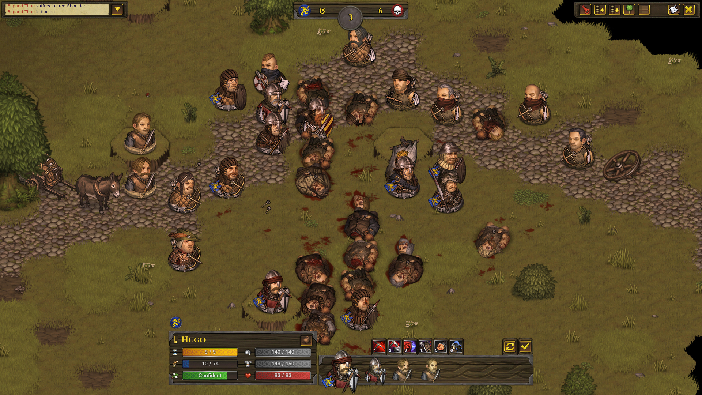
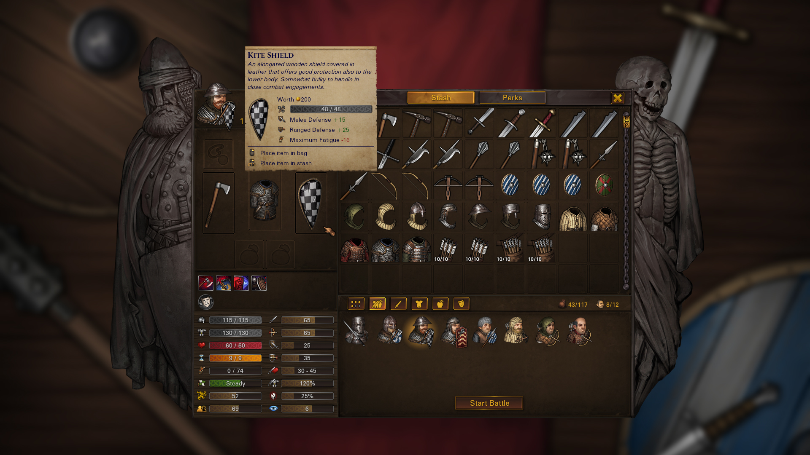

# UI and audio-visual intent

Provenance: copied from `/home/jan/Sources/total-brothers/docs/battle-brothers-use-cases.md` SHA256 `0ccec5426118234ae18853aadaebf334de33eebbb097a323099b542f36e1ac87` (4418 lines, 330 `UC-*` ids, 77 `UNCONFIRMED` markers). This is a reusable player-loop catalog for a mercenary company, not a kingdom or Total War brief, and not a recovered numeric formula sheet. Authority and implementation are separate columns. Catalog confidence is not original-runtime confirmation. The local Battle Brothers install was not executed. Prototype screenshots from the old slice are rejected as original-game references.

Parity is not claimed for any row. Only `UC-COMBAT-065` has a separate static implementation note, and that note does not accept the catalog's 9 AP cost, perk gate, or full-turn claim.

Inspection frames linked here are official Steam store assets, analysis-only, not shipped game art. See [authentic reference](05-authentic-reference.md).

## Trace table

| ID | Title | Authority | Confidence | Implementation | Code | Tests | Next evidence |
| --- | --- | --- | --- | --- | --- | --- | --- |
| UC-UI-001 | Everything mechanical has a tooltip | public catalog copy, not recovered bytecode | catalog-stated, not runtime-confirmed | absent | gap | gap | native reference comparison; original runtime was not executed |
| UC-UI-002 | World HUD | public catalog copy, not recovered bytecode | catalog-stated, not runtime-confirmed | absent | gap | gap | native reference comparison; original runtime was not executed |
| UC-UI-003 | Tactical HUD | public catalog copy, not recovered bytecode | catalog-stated, not runtime-confirmed | absent | gap | gap | native reference comparison; original runtime was not executed |
| UC-UI-004 | Pause is Space on overworld, not a combat freeze-rewind | public catalog copy, not recovered bytecode | catalog-stated, not runtime-confirmed | absent | gap | gap | native reference comparison; original runtime was not executed |
| UC-UI-005 | Inventory split panels | public catalog copy, not recovered bytecode | catalog-stated, not runtime-confirmed | absent | gap | gap | native reference comparison; original runtime was not executed |
| UC-UI-006 | Tactical overlays | public catalog copy, not recovered bytecode | catalog-stated, not runtime-confirmed | absent | gap | gap | native reference comparison; original runtime was not executed |
| UC-UI-007 | Confirm destructive actions | public catalog copy, not recovered bytecode | catalog-stated, not runtime-confirmed | absent | gap | gap | native reference comparison; original runtime was not executed |
| UC-UI-008 | Keyboard shortcuts parity (reference set) | public catalog copy, not recovered bytecode | catalog-stated, not runtime-confirmed | absent | gap | gap | native reference comparison; original runtime was not executed |
| UC-UI-009 | Auto-end-turn option | public catalog copy, not recovered bytecode | catalog-stated, not runtime-confirmed | absent | gap | gap | native reference comparison; original runtime was not executed |
| UC-UI-010 | Speed in combat is animation speed | public catalog copy, not recovered bytecode | catalog-stated, not runtime-confirmed | absent | gap | gap | native reference comparison; original runtime was not executed |
| UC-UI-011 | Hit percent shown before commit | public catalog copy, not recovered bytecode | catalog-stated, not runtime-confirmed | absent | gap | gap | native reference comparison; original runtime was not executed |
| UC-UI-012 | Contract and ambition trackers | public catalog copy, not recovered bytecode | catalog-stated, not runtime-confirmed | absent | gap | gap | native reference comparison; original runtime was not executed |
| UC-UI-013 | Accessibility minimums | public catalog copy, not recovered bytecode | catalog-stated, not runtime-confirmed | absent | gap | gap | native reference comparison; original runtime was not executed |
| UC-AV-001 | Overworld visual language | public catalog copy, not recovered bytecode | catalog-stated, not runtime-confirmed | absent | gap | gap | native reference comparison; original runtime was not executed |
| UC-AV-002 | Tactical visual language | public catalog copy, not recovered bytecode | catalog-stated, not runtime-confirmed | absent | gap | gap | native reference comparison; original runtime was not executed |
| UC-AV-003 | Portraits and paper dolls | public catalog copy, not recovered bytecode | catalog-stated, not runtime-confirmed | absent | gap | gap | native reference comparison; original runtime was not executed |
| UC-AV-004 | Audio buses | public catalog copy, not recovered bytecode | catalog-stated, not runtime-confirmed | absent | gap | gap | native reference comparison; original runtime was not executed |
| UC-AV-005 | Feedback for unseen systems | public catalog copy, not recovered bytecode | catalog-stated, not runtime-confirmed | absent | gap | gap | native reference comparison; original runtime was not executed |
| UC-AV-006 | Linux display realities | public catalog copy, not recovered bytecode | catalog-stated, not runtime-confirmed | absent | gap | gap | native reference comparison; original runtime was not executed |
| UC-UI-014 | Engage screen before combat | public catalog copy, not recovered bytecode | catalog-stated, not runtime-confirmed | absent | gap | gap | native reference comparison; original runtime was not executed |
| UC-UI-015 | Relations colour bands | public catalog copy, not recovered bytecode | catalog-stated, not runtime-confirmed | absent | gap | gap | native reference comparison; original runtime was not executed |
| UC-AV-007 | Morale and death audio stingers | public catalog copy, not recovered bytecode | catalog-stated, not runtime-confirmed | absent | gap | gap | native reference comparison; original runtime was not executed |

## Scenarios

Preconditions, main flows, alternate and exception flows, and observable results are copied. `UNCONFIRMED` markers are kept.

### UC-UI-001 — Everything mechanical has a tooltip

**Tags:** `ui | meta`
**Actor:** Player
**Precondition:** Hover any stat, perk, item, contract, difficulty option, status icon.
**Main flow:**
1. Show numbers and plain-language effect.
2. Tactical targeting shows hit % and expected damage band.
**Alternate / exception flows:**
- Controller/gamepad is optional later; mouse+keyboard is the vertical-slice target.
- Do not require opening a wiki.
**Observable result:** Hovering Melee Defence on a sheet explains that it is subtracted from attacker skill.

### UC-UI-002 — World HUD

**Tags:** `ui | overworld`
**Actor:** Player
**Precondition:** World map.
**Main flow:**
1. Show: day, phase, pause/speed, crowns, food days remaining, tools, meds, ammo, roster count, renown, active contract, active ambition, camp toggle, relations button.
**Alternate / exception flows:**
- Food-days should assume current roster and terrain, not a mystery number.
**Observable result:** A tester can read '3 days of food' before marching into desert.

### UC-UI-003 — Tactical HUD

**Tags:** `ui | combat`
**Actor:** Player
**Precondition:** Battle.
**Main flow:**
1. Turn order bar, AP, fatigue, morale, skills, wait/end, retreat, end round, inventory, overlays (ZoC, blocked, height), speed, log.
**Alternate / exception flows:**
- Colour-blind-safe hit/miss (not colour-only).
**Observable result:** During a brother’s turn, his six skill slots are clickable with AP costs shown.

### UC-UI-004 — Pause is Space on overworld, not a combat freeze-rewind

**Tags:** `ui`
**Actor:** Player
**Precondition:** Either map.
**Main flow:**
1. Overworld: Space pauses time.
2. Combat: already turn-based; Space may skip animation or pause SFX — lock without breaking rules.
**Alternate / exception flows:**
- Do not implement XCOM-style interrupt rewind.
**Observable result:** Holding the game overnight on a paused world map consumes no food.

### UC-UI-005 — Inventory split panels

**Tags:** `ui | economy`
**Actor:** Player
**Precondition:** C or I.
**Main flow:**
1. Stash | paper doll | formation. Repair marks. Comparison diffs.
2. Esc closes.
**Alternate / exception flows:**
- Smith Alt-click only when that shop is the context.
**Observable result:** One screen teaches formation, gear, and stash together.

### UC-UI-006 — Tactical overlays

**Tags:** `ui | combat`
**Actor:** Player
**Precondition:** Battle.
**Main flow:**
1. B blocked tiles, T trees, optional: movement range heatmap, ZoC, spearwall threatened hexes, height numbers.
**Alternate / exception flows:**
- Overlays are toggles, not hold-only, for accessibility.
**Observable result:** A new player can display why a hex is illegal.

### UC-UI-007 — Confirm destructive actions

**Tags:** `ui`
**Actor:** Player
**Precondition:** Retreat, dismiss, cancel contract, retire, delete save, End Round.
**Main flow:**
1. Modal confirm with cost spelled out (renown −15, etc.).
**Alternate / exception flows:**
- Ironman wording is stronger.
**Observable result:** A misclick on Retreat does not fire without confirm.

### UC-UI-008 — Keyboard shortcuts parity (reference set)

**Tags:** `ui`
**Actor:** Player
**Precondition:** Default keybindings.
**Main flow:**
1. World: WASD pan, wheel zoom, Space pause, F5/F9 save/load, Esc menus, F footprints, T camp, R relations, C/I inventory, Ctrl+click attack neutral.
2. Tactical: 1–0 skills, overlays, camera height, C/I on own turn.
3. Remappable in options (clone should, even if vanilla is limited).
**Alternate / exception flows:**
- Document in a pause-menu help card.
**Observable result:** Pressing T on the world map camps without opening a nested menu.

### UC-UI-009 — Auto-end-turn option

**Tags:** `ui | combat`
**Actor:** Player
**Precondition:** Options.
**Main flow:**
1. When AP=0, either auto-advance or wait for End Turn click.
**Alternate / exception flows:**
- Default on is OK if tooltip exists.
**Observable result:** With option off, a 0-AP unit stays selected until the player clicks End.

### UC-UI-010 — Speed in combat is animation speed

**Tags:** `ui | combat`
**Actor:** Player
**Precondition:** Battle.
**Main flow:**
1. 1×/2×/3× (or similar) speeds up tweens, not the number of actions per round.
**Alternate / exception flows:**
- Does not skip player decision time.
**Observable result:** Enemy turns finish faster at 3×; player still has unlimited think time.

### UC-UI-011 — Hit percent shown before commit

**Tags:** `ui | combat`
**Actor:** Player
**Precondition:** Skill selected, cursor on enemy.
**Main flow:**
1. Display computed % and whether ZoC/height/surround already included.
**Alternate / exception flows:**
- If a move+attack is previewed, show both costs.
**Observable result:** Player can decline an 8% shot without spending AP.

### UC-UI-012 — Contract and ambition trackers

**Tags:** `ui | economy`
**Actor:** Player
**Precondition:** Active objectives.
**Main flow:**
1. Always visible; click pans to map marker if any.
**Alternate / exception flows:**
- Expired contract changes colour then fails.
**Observable result:** A coin marker and a remaining-days number are visible without opening a log.

### UC-UI-013 — Accessibility minimums

**Tags:** `ui`
**Actor:** Player
**Precondition:** Options.
**Main flow:**
1. Font scale, colour-blind palettes, reduce flash, mute buses, disable camera shake.
2. Linux: windowed and fullscreen, integer scaling if pixel art.
**Alternate / exception flows:**
- Voice-over not required.
**Observable result:** A 4K window still readable at 125% UI scale.
---

### UC-AV-001 — Overworld visual language

**Tags:** `ui | overworld`
**Actor:** Player
**Precondition:** World map.
**Main flow:**
1. Readable biomes at a glance (snow, desert, forest, swamp, farmland, mountains, coast).
2. Settlement size readable from icon silhouette.
3. Faction colours on banners, not only on tooltips.
4. Fog is animated but never hides UI.
**Alternate / exception flows:**
- Pixel or painted — art direction is clone-original.
- Weather VFX optional, cosmetic.
**Observable result:** A screenshot without UI still tells forest from desert.

### UC-AV-002 — Tactical visual language

**Tags:** `ui | combat`
**Actor:** Player
**Precondition:** Battle.
**Main flow:**
1. Facing-less 2D/2.5D hexes with height steps obvious.
2. Team colours or outlines on units.
3. Corpses remain this battle then clear.
4. Hits: distinct head vs body FX; blocks vs HP splat.
**Alternate / exception flows:**
- Do not copy unique monster silhouettes one-to-one; redesign beasts as original grim fauna.
**Observable result:** Height is obvious without the overlay; a unit on a hill reads as up.

### UC-AV-003 — Portraits and paper dolls

**Tags:** `ui | company`
**Actor:** Player
**Precondition:** Roster.
**Main flow:**
1. Each brother has a unique-enough portrait from layered parts (hair, beard, scars, age).
2. Paper doll shows equipped armour/weapons so inventory changes are visible in combat sprites too.
**Alternate / exception flows:**
- Permanent injury can add an eyepatch/scar layer.
**Observable result:** Equipping a kettle helm changes both portrait overlay and tactical sprite.

### UC-AV-004 — Audio buses

**Tags:** `ui`
**Actor:** Player
**Precondition:** Options.
**Main flow:**
1. Buses: Master, Music, SFX, UI, Ambient.
2. Music: overworld travel bed, tension when hunted, battle layers, defeat stinger, tavern sting.
3. SFX: footsteps by terrain, weapon material, morale break wail, night insects.
4. Original score — no ripped OST.
**Alternate / exception flows:**
- Mute music independently.
- Combat hits must never be silent on a successful blow.
**Observable result:** Dragging SFX to 0 keeps music; a hit still shows numbers if SFX muted.

### UC-AV-005 — Feedback for unseen systems

**Tags:** `ui`
**Actor:** Player
**Precondition:** Hidden rolls (haggle annoyance, event chance, desertion).
**Main flow:**
1. Never show the hidden seed, but always show **outcomes** with enough text ('the alderman bristles; he will not be pushed further').
**Alternate / exception flows:**
- Optional later: a 'show chances' accessibility cheat.
**Observable result:** A failed haggle is understandable without opening this catalog.

### UC-AV-006 — Linux display realities

**Tags:** `meta | ui`
**Actor:** Player
**Precondition:** Linux desktop, possible HiDPI, Wayland/X11.
**Main flow:**
1. Start in windowed; remember monitor; vsync option; no exclusive-fullscreen crash on alt-tab.
2. Frame cap.
**Alternate / exception flows:**
- Must not require proprietary shaders only available on one GPU vendor.
**Observable result:** Alt-tab from fullscreen restores the world-map pause state, not a black screen.
---

### UC-UI-014 — Engage screen before combat

**Tags:** `ui | combat | overworld`
**Actor:** Player
**Precondition:** Collision with a party.
**Main flow:**
1. Show: enemy name, estimated strength, day phase, terrain, fortification, Fight / Attempt to withdraw.
2. No auto-resolve button.
**Alternate / exception flows:**
- Contract-forced fights hide withdraw.
**Observable result:** Player can still back out if the enemy is not already locked in a chase.

### UC-UI-015 — Relations colour bands

**Tags:** `ui | economy`
**Actor:** Player
**Precondition:** Relations window.
**Main flow:**
1. Each faction has a numeric or stepped bar with colour. Tooltips explain price and contract effects.
**Alternate / exception flows:**
- Houses and settlements both listed.
**Observable result:** A hostile house is immediately distinct from an allied city-state.

### UC-AV-007 — Morale and death audio stingers

**Tags:** `ui | combat`
**Actor:** Player
**Precondition:** A brother dies or a squad breaks.
**Main flow:**
1. A short, original audio sting; screen may flash but respect 'reduce flash'.
2. Do not play licensed music.
**Alternate / exception flows:**
- Can be muted on the SFX bus.
**Observable result:** A death is audible even if the camera is looking at the other flank.

## Catalog section introductions

These paragraphs sat above the use cases in the source catalog and are copied verbatim.

# 13. Audio / visual player-facing needs (intent, not asset theft)

Do **not** rip reference sprites, portraits, music, or fonts. Describe the **job** each layer does.
